# Bounded asynchronous laser preview preparation

Status: experimental integration; no calibrated scanning or live-rate qualification.
Base: `4d10668270cac41835b8b1c4af9d5c3862f1df5f`.
Implementation: `89089708cefcce6e45ce98e7965c741f5673a7b4`; documentation binding follows it.

## Ownership and failure boundaries

The helper previously computed both full-frame histograms and thumbnails inside
its reconstruction callback before offering a Snapshot. That preparation cost
about 6.7 ms on the measured Raptor pairs. It now offers an owned **Pending** input;
the existing publisher thread computes the same Snapshot before encoding/writing.
No thread per frame, new dependency or numerical algorithm is introduced.

`laser_display/pending.rs::Pending::capture` validates the two GREY images and
metadata bounds, copies raw Frame data and at most 4096 candidate positions, and
retains profiles, indices, timestamps, raw PTS and compact result/error counters.
It does not clone full query outcomes or retain session history. WorkControl is
checked before transfer and between raw frame copies. Processing errors retain
the existing bounded error message and empty-candidate semantics.

`helper.rs::offer` replaces one pending mailbox item, counting replacement as a
preview omission. `helper.rs::publish` takes ownership, releases the mailbox lock,
then calls `Pending::finish` for the existing FrameView histogram/thumbnail math,
Snapshot validation and subsequent transport. Source reuse cannot change the
owned input. Output I/O also holds no mailbox lock. The parent continues to use its
own one-slot Snapshot mailbox; its omission counter remains separate.

```mermaid
flowchart LR
  Raw[Required raw journals] --> Engine[Existing pair engine]
  Engine --> Log[Required complete pair journal]
  Log --> Copy[Bounded raw/result copy]
  Copy --> Mail[One Pending input]
  Mail --> Prepare[Publisher: histograms and thumbnails]
  Prepare --> Encode[Validate and encode Snapshot]
  Encode --> Pipe[Helper pipe]
  Pipe --> Parent[Parent latest Snapshot and GUI]
```

Required pair journaling/flush still precedes optional preview transfer. Handoff,
worker preparation or encoding rejection increments omissions without cancelling
raw acquisition. Actual write/flush failure still requests cleanup. The existing
Stop/Abort/helper-ownership and publication boundaries are unchanged. The publisher
acquires completion before its final mailbox take and is joined before completion
is sent, preserving the last pending preview. No hard driver/file/scheduler/pipe
or whole-application shutdown bound is claimed (SCAN-REV-005 remains open).

Workflow `optional_previews.accepted` means the handoff was accepted, not that it
was displayed. Worker-side rejections and later overwrites appear in helper
omissions. This distinction already existed for transport encoding; preparation
can now also reject after handoff. All numerical output remains in required
journals independently of preview eligibility.

## Additional memory

The existing image limit is 4,194,304 pixels per GREY frame, and metadata is capped
at 4096 bytes. One Pending therefore owns at most 8 MiB of raw payload plus 8 KiB
of metadata and bounded positions/counters. At most three sets can coexist in this
handoff: a producer copy, the waiting item and the worker's item. The additional
raw-payload bound is **24 MiB**, plus at most 24 KiB metadata, 288 KiB position
values and 12 KiB error-text values across those sets. Structs, allocator overhead, histogram/thumbnail/output
buffers and all pre-existing source/processing/GUI allocations are additional.
This is a handoff bound, not a whole-process RSS or 60-minute stability proof.

Actual Raptor pairs copy 4,608,000 raw bytes. A private replay probe's three-pending
snapshot records RSS 212,508 → 219,260 KiB; dropping them does not immediately
return allocator pages to the OS. The process also holds recording/replay and
engine allocations. That observation neither isolates all preview memory nor
replaces the structural bound or a sustained resource test. No zero-copy claim is
made; changing core Frame storage is unnecessary for this measured transfer cost.

## Controlled comparison

A private release-mode probe embeds the exact old Snapshot preparation and exact
new Pending code. It loads five actual retained Raptor pairs, runs 13 iterations
per pair, excludes the first warm-up, alternates old/new order in the same binary,
and compares the complete serialized Snapshot bytes after each comparison.
All **65 comparisons are byte-identical**, including raw statistics, thumbnails,
positions, detector counters and frame metadata. Source/body/executable hashes and
all commands are retained privately. Preparation is timed sequentially here;
this does not measure concurrent scheduling, GUI latency or pipeline throughput.

Twelve-iteration medians, milliseconds:

| Retained pair | Old producer preparation | New producer copy | Worker preparation | New sequential total |
| --- | ---: | ---: | ---: | ---: |
| 0 | 6.697 | 0.224 | 6.708 | 6.960 |
| 4 | 6.710 | 0.203 | 6.684 | 6.897 |
| 9 | 6.706 | 0.195 | 6.710 | 6.904 |
| 14 | 6.680 | 0.190 | 6.662 | 6.872 |
| 18 | 6.665 | 0.186 | 6.701 | 6.904 |

The change moves expensive work off the required processing path; it slightly
increases total work and memory because it copies raw inputs. The producer timing
ratio must not be presented as an application or preview-rate speedup. The engine
itself previously measured 43–46 ms on this workload, before journaling/transfer.

## Regression and actual-device evidence, 2026-11-03

Formatting, strict all-target Clippy, **779 Rust tests** and release build pass.
Five new regressions cover source reuse after handoff with exact original output;
invalid payload/dimensions/flags/metadata and cancellation/error bounds; maximum
4 MiB images with 4096-byte metadata; a slow actual publisher callback while offers
continue, including overwrite accounting/final drain; and rejected worker
preparation followed by healthy publication without cancelling raw work. Existing
real replay-helper, BrokenPipe, Stop/EOF/Abort and root-close tests still pass.
The first compile needed an explicit PreviewInput lifetime on its callback;
corrected without lint suppression. An initial 778-test gate precedes the final
maximum-boundary regression; the final gate covers 779.

Private native GUI testing uses the existing `LP_NUM_THREADS=2` Xvfb condition.
A finite trial saves **32 raw frames per camera**, processes **22 pairs**, records
10/8 processing drops and one unmatched second input, and produces 1879–2066
candidates per pair (42,593 values). Startup rejected buffers are 1/2, ongoing 0/0.
The **68.75% processed raw-frame fraction remains below 90%**. This is different
incoming data/scheduling from earlier trials, not a controlled whole-pipeline
speedup comparison. The helper reports seven preview omissions; no 20-FPS preview
or p95-latency pass is claimed.

An actual root-close-during-acquisition trial saves **9 raw frames per camera and
8 pairs** (15,467 values), with one processing drop per camera, no unmatched input,
startup rejects 1/90 and ongoing 0/0. One observed close-to-exit time is 0.334 s,
not a hard bound. Both trials pass raw integrity/publication/restoration and exact
complete before/after stream plus illumination GET readbacks, including restored
original property 151. All-task sampling observes helper camera descriptors and
none in the GUI; both helpers and apps exit. Screenshots show both raw camera
images and final diagnostic candidates. Default-renderer failures remain unresolved.

Actual device-free replay of the finite bundle emits three previews/completion,
retains all 32 raw frames per camera and explicitly reports 29 processing drops
per camera because input is unpaced. All three actual IPC preview bodies are
byte-identical to old Snapshot preparation on their retained inputs, after setting
its runtime omission counter. Completion accounting conserves processed pairs as
published plus omitted previews. Separate replay verifies all **33 reports /
63,924 candidate values**, every frame CRC/sequence/flags/time/PTS reference and
complete pair-record bytes against the unchanged base serializer. All three
artifact manifests match their lengths/CRCs. This is same-engine integrity proof,
not independent physical geometry or sustained acquisition qualification.

## Remaining duration and reconstruction work

An additional capacity gap is confirmed in `laser_stream/bundle.rs::Plan::open`:
schema 1's required full-report pair log is capped at 1 GiB. This finite trial averages
1,110,905 bytes per record. If that size persisted at 27 processed pairs/s (90% of
30-FPS input), the maximum cap would hold approximately 966 records or 35.8 seconds.
This is conditional arithmetic, not a soak measurement. Dense 30-minute scans
therefore require a deliberate long-session journal/storage/recovery policy;
preview decoupling alone cannot satisfy that requirement. The independent reviewer
subsequently confirms this gap as SCAN-REV-024; the developer response accepts it
and records coordinated follow-up work. That preview milestone implements no capacity fix. Subsequent opt-in schema 2
adds [bounded segments and recovery](SEGMENTED_LASER_JOURNAL.md); sustained
qualification remains outstanding.
Do not blindly remove
caps or hide observations. The older IR 1000-frame limit (SCAN-REV-021) is unchanged.

Physical geometry/units/coverage, tracking/fusion, direct stream-bundle reopen,
persistent models and complete calibrated scan-to-mesh workflows remain incomplete;
physical calibration is deferred. No physical qualification flag changes.

New handoff code independently adapts the project's own helper/Snapshot patterns;
FrameView/statistics/geometry algorithms are reused unchanged. No copied upstream
implementation, new dependency/license, firmware action, physical calibration,
developer modification of reviewer-owned files or merge. Private raw/model/probe/screenshot evidence
stays outside Git/uploads. CodeRabbit 0.9.2 quota/billing lookups remain unavailable,
so independent review/publication are pending. Exact commits, source/binaries and
evidence hashes are in the recovery checkpoint and developer response.
