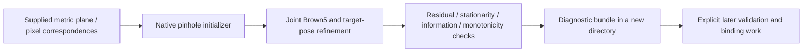

# Offline Brown5 calibration refinement

Status: experimental numerical fitting, not physically qualified Raptor calibration.
Physical calibration remains deferred. This workflow reads supplied target/pixel
correspondences; it never opens a camera, changes firmware, selects a factory
mapping or installs an active capture calibration. No board images are captured.

`scancraft_calibration::refinement::refine_planar` jointly fits camera intrinsics,
Brown5 distortion and each target pose from a supplied pinhole initializer.
`scancraft-workflow::planar_calibration` owns the bounded-file workflow;
`scancraft-cli calibrate-planar OBSERVATIONS_JSON NEW_OUTPUT_DIRECTORY` runs it.
No GUI board/calibration workflow is claimed.



## Model and solver

Targets use `[X,Y,0]` millimeters; `camera_from_target` uses +X right, +Y down,
+Z forward. Wrong board dimensions can give wrong metric poses despite small
residuals. Supplied provenance is a declaration, not physical/device attestation.

Global variables are log focal lengths, principal point, optional skew and
`k1,k2,k3,p1,p2`. Default skew is fixed to zero, including when the initializer
estimated nonzero skew; `estimate_skew: true` fits it instead. Each pose has three
local rotation increments and three independent millimeter translations. All 16
analytic derivative columns are checked against central finite differences.

The objective is summed squared Euclidean pixel residuals, without robust loss
or automatic outlier removal. Damped normal equations eliminate independent 6×6
per-view blocks into a 10×10 global Schur system (one fixed variable with zero
skew). Cholesky and back substitution use existing nalgebra. No full
observations-by-all-parameters Jacobian is allocated. Solver-block storage grows
with view count; observations/input bytes still occupy memory. This is a
structural bound, not an RSS benchmark.

There are at most 100 outer iterations (default 80), with at most 16 damping
trials each. Accepted trials must strictly reduce finite cost. A heavily damped
tiny step alone is insufficient for convergence. Final scaled-gradient infinity
norm must be at most `1e-6`; scaled pose-eliminated information minimum eigenvalue
must be at least `1e-10`. These are numerical policies, not covariance, physical
confidence or coverage. Normal equations square conditioning; conservative
rejection is possible. Large target-coordinate offsets can worsen pose-block
conditioning; arbitrary-origin robustness is not guaranteed.

The model must pass existing conservative Brown monotonicity validation on the
disk reaching the maximum observed normalized radius. That radius is reported as
`observed_max_normalized_radius`, **not** a qualified lens domain: it proves
neither angular coverage nor valid extrapolation. `RefinedPlanarCalibration` is
separate from `CameraModel`/`CalibrationRecord`; no conversion to RAPCAL01 occurs.

## Input, cancellation and persistence

Schema 1 requires `provenance` (`synthetic_fixture` or
`user_supplied_unverified`), `image_size`, `views`,
`initial_max_reprojection_error_px`, and `refinement` with `max_iterations`,
`max_reprojection_error_px`, `estimate_skew`. Each view contains `observations`,
each with `target_xy_mm` and `pixel`. Unknown fields/nonfinite JSON numbers fail.
The coarse seed limit and final individual-error limit are distinct: a pinhole
seed need not already satisfy the final distorted-camera limit.

The initializer's 3–64 views, 4–4096 points per view, bounded finite coordinates
and image policies apply. Refinement additionally requires more scalar residuals
than parameters: `2 * total_points > globals + 6 * views`, with 9 or 10 globals.
This is necessary, not sufficient; final information checks reject unobservable
arrangements. The file workflow accepts regular JSON files at most 16 MiB,
independently of the Rust API's observation caps.

Cancellation latches once observed, even if a callback later clears. Refinement
checks per view, every 256 observations and each damping trial. The CLI reuses
scoped SIGINT/SIGTERM handlers. File I/O, synchronization and initializer SVD are
not preempted inside their calls; no whole-command shutdown bound or resolution
of SCAN-REV-005 is claimed.

Successful fits retain exact supplied bytes as `observations.json`, write
`fit.json` (initializer, refinement, false physical/device flags), and checksum
both in `manifest.json`. Existing staging/fsync/atomic no-overwrite primitives
protect existing output. Failure before staging publishes nothing; write failures
retain the named partial folder. Parent-sync failure after publication explicitly
reports the already-published bundle. CRC detects accidental corruption, not
authenticity. Input bytes are never written. This output is neither a scan-project
container nor a capture-calibration record.

## Provenance and rationale

Independent MIT Rust implementation, not copied or translated upstream code.
Mathematical references:

- Zhang [MSR-TR-98-71](https://www.microsoft.com/en-us/research/wp-content/uploads/2016/02/tr98-71.pdf),
  section 3.2 for reprojection refinement; Brown5/skew policy here is explicit,
  not a claim to implement the report's complete procedure.
- [OpenCV camera geometry](https://docs.opencv.org/4.13.0/d9/d0c/group__calib3d.html)
  for Brown projection conventions and independent numerical comparison.
- [Ceres nonlinear least-squares documentation](https://ceres-solver.readthedocs.io/latest/nnls_solving.html)
  for damping and Schur elimination concepts, not imported solver code.

No paper assets or library implementation source are imported. Existing
Apache-2.0 nalgebra 0.35.0 supplies algebra. No dependency/version/license or
mandatory native runtime changes. This follows the native Rust mission, reuses
existing projection/pose semantics, and separates fitting from device/configuration
state. No performance or accuracy advantage over mature libraries is asserted.
This local optimizer is not a general replacement for Ceres or OpenCV tooling.

## Reproduction and evidence

```sh
cargo run --frozen --release -p scancraft-calibration --example brown_reference > /tmp/brown-cases.json
python3 -m venv /tmp/brown-reference-venv
/tmp/brown-reference-venv/bin/python -m pip install -r tools/reference-requirements.txt
/tmp/brown-reference-venv/bin/python tools/compare_brown_calibration_opencv.py /tmp/brown-cases.json /tmp/brown-comparison.json
python3 - <<'PY'
import json
from pathlib import Path
case = json.loads(Path('/tmp/brown-cases.json').read_text())['cases'][2]
Path('/tmp/planar-observations.json').write_text(json.dumps(case['request']))
PY
cargo build --frozen --release -p scancraft-cli
target/release/scancraft-cli calibrate-planar /tmp/planar-observations.json /tmp/new-planar-fit
tools/check.sh
```

Seven numerical tests cover exact distorted-camera fits/skew/poses, metric-scale
invariance, derivatives, noisy fits/final limits, persistent/transient cancellation,
nonconvergence, invalid options/seeds/degrees of freedom and unobservable repeated
pinhole views. Two workflow tests cover request-byte preservation, artifact CRCs,
no-overwrite, malformed schema, oversize input and cancellation.

The three synthetic reference cases each have 12 views ×99 points: exact zero
skew, exact nonzero skew and deterministic 0.02-pixel component noise. NumPy
independently recomputes residuals and known-truth errors. Zero-skew cases compare
with OpenCV 5.0.0 full Brown5 refinement from the same pinhole seed, using float32
OpenCV observations. Nonzero skew is checked against truth/NumPy only. Test-only
OpenCV/NumPy are isolated from the application runtime.

The noisy RMS changes from about 0.740283 to 0.019822 pixels; maximum Rust/OpenCV
intrinsic discrepancy is below 0.000079 pixels, distortion discrepancy below
0.000044. Deliberately altering k1 makes the reference checker fail. Exact values,
thresholds, hashes and release CLI evidence are retained in
`reviews/evidence/2026-10-27-brown-calibration-reference.json`.

No real target was captured/calibrated. Model suitability, target detection and
subpixel localization, robust selection, coverage/uncertainty, joint stereo
estimation, Raptor optical/mode binding, synchronization, physical accuracy and
repeated hardware qualification remain incomplete. SCAN-REV-006 remains under
independent review; synthetic numerical results do not close it.

The combined source gate passed 598 Rust tests, formatting, strict all-target
Clippy and release build (exit 0). Source/log and synthetic runtime hashes are
recorded in 2026-10-27-brown-calibration-reference.json. These are software gates,
not hardware qualification.
