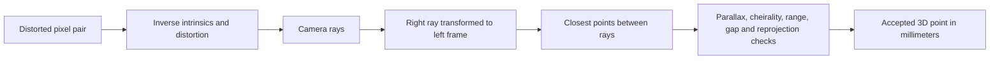

# Camera geometry and calibration records

The `scancraft-calibration` crate is an independent Rust mathematical foundation.
It does **not** yet estimate calibration from a board, decode Raptor factory
calibration, establish a supported scanner optical model, or produce a real
Raptor point cloud. Physical calibration remains deferred by user request.

## Coordinates and model

Camera coordinates use +X right, +Y down, +Z forward. Translations and 3D
positions are millimeters; image coordinates are pixels with integer pixel
centers starting at (0,0). `right_from_left` transforms a left-camera point
into right-camera coordinates: `p_right = R * p_left + t_mm`. The right camera
origin in left coordinates is `-R.transpose() * t_mm`. Rotations must be
right-handed and orthonormal. No implicit reflection, scaling or axis change
is applied.

The implemented model is pinhole plus five Brown distortion coefficients:
k1/k2/k3 radial and p1/p2 tangential, with optional intrinsic skew. This is a
subset of the models described by the [OpenCV camera geometry reference](https://docs.opencv.org/4.13.0/d9/d0c/group__calib3d.html).
Unsupported rational, fisheye, thin-prism and tilted-sensor models must be
implemented and validated if actual scanner evidence requires them. The
current model must not be assumed to fit the Raptor.

`valid_radius` specifies the supported undistorted normalized-image disk.
It must come from calibration coverage, not a guessed device specification.
Validation finds cubic minima at endpoints and stationary points. A
conservative bound on the symmetric tangential Jacobian ensures the full
mapping remains strongly monotone over that disk. Numerically folded or
insufficiently conditioned models fail validation. Inverse distortion uses
bounded damped Newton iterations and the analytic Jacobian; failure or an
out-of-domain observation returns an error rather than an invented ray.



A prepared stereo model validates once and caches extrinsic matrices before
processing correspondences. Its input limits are explicit: minimum ray angle,
left Z depth range, maximum ray gap and maximum reprojection error. These are
algorithm policies, not manufacturer claims. Matching, rectification,
synchronization, confidence estimation and scan fusion are separate work.

## Persistence and provenance

Calibration files use RAPCAL01 magic, little-endian u32 JSON-body length,
u32 CRC32, and a versioned JSON body capped at one MiB. Every coefficient,
unit/convention marker and declared binding is checked before use. Unknown
fields and schemas, corrupt/truncated files and trailing bytes are errors.
CRC provides accidental-corruption detection, not authentication.

Records explicitly distinguish synthetic fixtures, estimated observations,
device readouts and imports. The capture-binding guard rejects known synthetic
fixtures and mismatched declared serial, firmware, mode or image sizes. A
matching declaration does not establish physical provenance or accuracy. The
application has not yet integrated a calibrated native scanning workflow.

## Independent numerical comparison

The synthetic reference example creates two rotated, asymmetric cameras and
60 known points. They are explicitly labeled synthetic and are not scanner
parameters. A separate test-only OpenCV 5.0.0 environment compares projection,
inverse distortion, and triangulation against the Rust result. The Rust ray
midpoint method and OpenCV's triangulation are independent implementations;
only clean, exact correspondences are used for this agreement check.

```sh
cargo run --release -p scancraft-calibration --example synthetic_reference_cases > evidence/synthetic-calibration-reference-cases.json
python3 -m venv .venv-reference
.venv-reference/bin/python -m pip install -r tools/reference-requirements.txt
.venv-reference/bin/python tools/compare_calibration_opencv.py evidence/synthetic-calibration-reference-cases.json evidence/calibration-opencv-comparison.json
```

OpenCV and NumPy are not production application dependencies. Their isolated
environment is excluded from git. The observed maximum 3D discrepancy was
about 1.08e-8 mm for these synthetic cases; this is numerical agreement,
**not physical scanner accuracy or dimensional qualification**.
