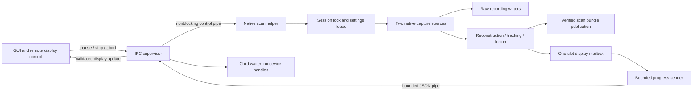

# Capture process isolation: development contract

Status: preview/recording and native live-scan helpers implemented; physical
driver-stall qualification remains outstanding; discovery now uses a read-only helper.
Independent SCAN-REV-005 remains open. This document does not establish a bounded
whole-application shutdown or hardware qualification.

## Existing ownership

The preview GUI starts `capture_worker::Worker`, whose closure invokes
`capture_process::run`. That supervisor starts the same executable with an
internal `--capture-helper` entry point before eframe initialization. The helper
invokes `capture_session::run`, which owns the session lock, scanner capture,
recording writer and final publication. GUI code owns the bounded two-frame
preview channel and display-drop counters. Recording precedes preview delivery;
display backpressure does not skip saved raw frames. Cancellation and consumer
disconnection both stop the capture loop at its existing frame boundary.

`capture_session::with_close` explicitly invokes device close after ordinary
operation errors, including recording setup/write errors. It preserves the
operation failure and any close failure together. Final recording publication
requires both operation and explicit close success. Panics still use owned
resource Drop and the existing worker panic-reporting path; panic cleanup is not
newly qualified. Device calls, file I/O and close remain synchronous inside the child. Parent
process spawn/log-file operations and scheduling are not assigned a hard real-time
bound.

## Implemented preview process boundary

`capture_ipc` transports raw frames with a 64 MiB body limit and a 24-byte
fixed header plus metadata and image bytes. Completion uses bounded JSON (64 KiB).
Each frame is explicitly flushed before returning to capture, so a buffered
tail does not depend on the next capture. Flush errors are transport failures.
The decoder accepts fragmented reads, rejects inconsistent lengths, unknown
message kinds, truncation and bytes after completion. This is an internal protocol
between copies of the same executable, not a new recording format.

During preview capture, only the child opens the scanner and holds session locks. Its control thread
interprets stdin EOF or any control byte as a graceful stop request. The parent
reads stdout nonblocking in bounded batches, checks cancellation between batches
and requests stop by closing stdin. Ordinary Stop and ordinary window close keep
reading through recording finalization without starting a deadline. An explicit
abort (offered by the slow-close UI), application Drop, or loss of the preview
consumer starts a two-second grace, then returns an explicit cleanup-unconfirmed
failure if the helper remains live. This interval is a software grace policy,
not a measured physical driver shutdown bound. A surviving helper can still
finish publication; an unconfirmed result must not be presented as proof that
publication failed.

A reaper thread is allocated before helper launch. On parent-monitor exit it
receives the child handle and waits without joining the GUI or owning any device
restoration duties. The child retains actual device handles and locks until its
session cleanup finishes. No kill, USB reset or abandonment of a device-owning
thread is used. A helper blocked in kernel I/O may outlive the GUI; replacement
capture attempts must still acquire the existing session locks.

Each launch creates a private, exclusive, no-follow diagnostic file (mode 0600)
in the temporary directory. The helper writes its capture/cleanup outcome and
transport error to stderr independently of stdout IPC. Failure messages retain
its PID and diagnostic path. A helper that never returns cannot supply a final
cleanup outcome; timeout must remain unconfirmed. Disk failure/power-loss
persistence is not qualified. Successful completion requires the final message,
valid stream termination and successful process exit. Capture errors keep the
window open and show cleanup diagnostics rather than claiming the scanner stopped.

## Implemented native live-scan boundary

`live_process` starts a helper that owns the entire
`scancraft_acquisition::scan` call, including `SettingsLease`, both capture sources,
restoration, recording verification and final publication. The GUI worker owns
only process supervision and display transport. The existing native live-scan
button uses this path; synthetic GUI fixtures remain explicitly synthetic.

The control pipe sends pause/resume and a latched graceful Stop as bounded bytes.
Writes are nonblocking and retain the latest unsent state under backpressure.
Graceful Stop does not cancel `WorkControl` and has no two-second completion
limit: draining, fusion and publication must be allowed to finish. Explicit abort
or parent-control EOF cancels `WorkControl`, requests stop and starts the parent's
two-second abort grace policy. A timeout does not kill the helper or confirm
restoration. Ordinary root close first requests graceful Stop; after a prolonged
wait the user can explicitly abort while retaining partial data. Failure clears
pending close intent at the close boundary and preserves document checks.

Display progress has a 16 MiB serialized cap enforced during writing and before
reading. `Control::new_remote_display` accepts validated updates containing only
phase, counters and an optional display snapshot. It cannot run a local scan;
ordinary local controls reject imported display updates. Pause/stop atomics are
not serialized or overwritten by incoming display state. Cloud previews are
limited to 50000 finite points; thumbnail dimensions are nonzero, at most
320x240, and must match pixel counts. Parent mailbox replacements are counted
separately and added to the child's skipped-preview total.

The child progress sender polls every 30 ms, matching the existing GUI repaint
cadence instead of imposing a 10 Hz cap. No measured FPS/latency claim is made.
The child progress thread consumes the one-slot engine mailbox without holding
its mutex during serialization or pipe writes. Display validation or encoding-limit failures omit the preview, preserve counter
updates and increment the helper omission count. Only pipe write/flush failures
request abort. Final summaries expose `helper_omitted_previews`; rejected display
data does not change raw recording or engine publication validation. A blocked display writer does not own acquisition or reconstruction, and
parent-monitor exit closes the pipe. The stdout lock is held only while one prepared packet is written and flushed;
engine diagnostics must use stderr. The child joins its progress sender before
writing completion so packets cannot interleave. Completion carries a bounded
summary; the full per-pair report remains in the published folder's `report.json`
and is not copied into IPC. All hardware qualification flags remain false.

Helper diagnostic files include a startup PID/status marker and final outcome
when the helper returns. A missing final outcome remains unconfirmed.

## Ownership contract and remaining qualification

The helper must exclusively own device descriptors, session locks and restoration
duties. The GUI must own no device handles and must not synchronously wait for a
helper blocked in setup, capture, close or restoration. IPC must have explicit
length limits, bounded display queues and cancellation/disconnect semantics.
Recording must remain independent of display throughput. A helper's completion
message alone is insufficient if device cleanup can still occur after it.

Parent cancellation requests graceful cleanup. Timeout or parent exit must never
be reported as successful restoration. A helper that remains in an uninterruptible
kernel call may survive the GUI; it must retain its locks until descriptor cleanup
actually finishes, preventing a replacement session from racing it. Merely
sending a kill signal does not establish that the process or kernel operation has
terminated. Cleanup failures and incomplete recording locations need durable,
private diagnostics when the GUI exits before the helper.

Both preview recording and native live scanning now use the boundary. Preserve
current raw recording formats, partial-recording recovery, publication ordering,
control restoration and independent finding status. No forced scanner reset,
firmware change or weakening of validation is part of this work.

## Required validation before claiming isolation

Use real child-process tests with no scanner: stalled setup/read/close, parent
cancellation and exit, truncated/oversized IPC, full display queues, simultaneous
capture/write and restoration failure, helper panic/crash, lock retention after
parent timeout, and restart only after cleanup. Verify UI event polling and Drop
do not join a device-owning thread. Distinguish measured synthetic lifecycle bounds
from later physical disconnect/driver-stall qualification. Physical tests require
the permitted hardware environment; they have not been performed here.

## Validation to date

Device-free tests exercise protocol fragmentation and corrupt sizes, missing or
trailing completion data, actual child processes producing frames/completion,
nonzero exits, cancellation while a child remains stalled, and private diagnostics.
An actual child inherits an exclusive lock and waits for a release marker: the
supervisor worker finishes with an unconfirmed error while the lock remains
held; after child cleanup the lock becomes acquirable. Test teardown releases
the marker even on assertion unwind. No scanner, USB node, firmware or calibration
is touched by these fixtures. Native live-scan Drop now joins an IPC supervisor rather than a device-owning
thread. This does not establish a hard whole-application shutdown bound:
process launch, filesystem operations and scheduler latency
remain outside that claim, and real driver-stall/disconnect tests are outstanding.
Independent SCAN-REV-005 status remains under reviewer control.

The `scancraft --synthetic-live-process NEW_OUTPUT_DIRECTORY` diagnostic runs the
actual parent supervisor, helper process, synthetic engine and publication path
without GUI or scanner access. An integration test checks the report/summary
retain synthetic labels and false hardware qualification flags, reads both
recordings through CRC-checked footers (two frames per camera), and verifies a
retry cannot overwrite the saved report. Additional process tests distinguish
pause/resume, graceful Stop beyond the abort grace, explicit abort during a
stalled child, bounded summaries and invalid control bytes. No physical accuracy,
USB shutdown latency or current scanner connectivity is inferred from them.

`live_fixture` supplies the explicit synthetic engine session to GUI diagnostics
and process tests; process supervision does not depend on rendering code. These
internal helpers expect the executable's matching protocol; restart the GUI when
replacing development binaries. No persisted recording/project format is changed.

## Read-only discovery boundary

`discovery_process::Discovery` starts a worker that supervises the same executable
with `--discovery-helper`. Only the child calls device discovery, including
opening candidate video nodes and QUERYCAP; it does not acquire a capture session
or change scanner settings. Discovery uses the existing bounded completion
protocol and private diagnostics, rejecting frame messages. The GUI polls
completion without joining a live probe and prevents duplicate discovery and
capture starts while pending. Stop requests graceful cancellation but leaves the
pending guard active until actual child exit. Protocol/read failures also retain
the guard until exit; they cannot silently enable repeated probes while a child
is alive. An in-flight synchronous QUERYCAP may therefore leave discovery pending
indefinitely, with the UI continuing to poll. No helper is killed.

Discovery Drop separately requests abort and joins the IPC worker, so ordinary
application destruction can wait for the software grace plus unbounded process
launch/filesystem/scheduler latency. This is not a hard whole-app close deadline.
No actual stuck-driver or device discovery reliability qualification is claimed.
Unit tests check argument rejection, pre-launch cancellation, and nonblocking
poll/cancel while a simulated probe is deliberately stalled. Existing supervisor
process tests cover timeout and retained child ownership.
