# Sequential inspection of recorded laser captures

`scancraft-cli inspect-laser-capture CAPTURE_DIRECTORY --all` checks every stored
pair against its bundled raw frames and prints a summary only after successful
completion. It is offline and read-only. SIGINT/SIGTERM request cancellation;
failure emits no partial summary. A numeric argument still opens one pair, and
the existing GUI pair selector is unchanged.

This is a bridge from genuine recorded data to reconstruction/tracking research,
not a calibrated scanning mode. Coordinates remain in supplied, unverified
geometry units. Neither this command nor the reader creates a metric project,
fuses points, recomputes matching, or certifies a pose.

## Interface and implementation

`scancraft_workflow::laser_stream::bundle::visit_pairs(directory, work, visitor)`
returns the number of pairs after all checks succeed. Each callback receives a
zero-based index and the existing `candidate_bundle::Loaded` value, including
bounded candidate points, observation indices, report and camera thumbnails.

Callbacks are **provisional**. A later invalid raw reference, malformed typed
record, callback error, cancellation, changed file, or final counter discrepancy
can fail the whole operation after earlier callbacks. Consumers must stage their
state and publish only after `Ok`. The CLI keeps only local counters and prints
after success. Do not directly commit callbacks into a visible scan session.

```mermaid
flowchart LR
    Capture[Saved schema 1 or 2 capture] --> Preflight[Inventory, digests, request and complete journal checks]
    Preflight --> Raw[One validated Playback index per camera]
    Raw --> Stream[Second streaming journal pass]
    Stream --> Pair[Typed record and exact raw-frame binding]
    Pair --> Callback[Provisional callback; one pair at a time]
    Callback --> Final[Final journal, failure-count and source identity checks]
    Final --> Summary[Successful count or CLI summary]
```

Source: `laser_stream/bundle/load.rs::{read_inner, PairReader::load, visit_pairs}`;
existing `load_pair` uses the same internal path with one selected record.
`PairReader` factors the existing raw binding/display checks without changing
numeric geometry, acquisition, formats, quotas or dependencies. The complete
journal preflight validates all file/record-order digests before callbacks. A
second streaming pass parses and binds every pair; it checks completion again.
Both passes use the existing `pair_journal::visit(Complete)`. Full traversal also
compares observed processing-error records with the terminal report's count.

The reader retains two existing bounded raw indexes, guarded artifact descriptors,
one typed pair and its frames/views. It does not collect pair history or build a
whole-journal JSON tree. A consumer can retain callback values and is responsible
for its own memory bound. Index memory still scales with raw frame count; maximum
capture descriptor/RSS/finalization costs and 60-minute behavior are unqualified.
Two journal passes and whole-recording verification remain linear I/O, with no
hard wall-clock deadline. Empty captures are rejected. Original call success,
durability, authentic provenance and physical accuracy are not proved by CRCs.

This is independently written Rust orchestration reusing existing project code;
no external algorithm implementation or new third-party dependency was imported.
See [saved pair verification](SAVED_LASER_CAPTURES.md) for bounds and provenance.

## Validation

Baseline: `cbd9f53ee9da567da590c6d54e0fa8b449c6462b`. Private evidence is retained
in the developer artifact directory `capture-sequence-6o6k20vn`; raw scans and
probes are excluded from Git and review uploads. Commit/source/binary bindings
are recorded there and in the recovery checkpoint after commit.

- Full frozen workspace gate: 828 tests passed, one existing ignored capacity
  test; formatting, strict all-target Clippy and release builds passed. The
  >1 GiB capacity test was not rerun for this reader change. Initial Clippy caught
  a needless reference; corrected without suppressing the lint, then reran the gate.
- Four new tests in `load/tests.rs`: schema-1/2 exact individual/sequential views;
  later raw-reference failure, callback failure, cancellation and final mutation;
  preflight corruption with no callbacks; preserved processing failures and
  disagreement with terminal totals. Existing loader regressions still pass.
- A release-library reference probe checks nine historical/native capture folders,
  222 pairs and 391,481 candidate points against stored coordinates, observation
  indices and complete FrameViews reconstructed directly from raw frames. All
  comparisons are exact; all 199 original input files retain SHA-256. A frozen pre-change executable also passes its selected
  first/middle/last reference checks on those folders.
- Individual and sequential traversal produce identical full-view checksums on
  the 61-pair and 28-pair datasets. One elapsed observation including reference
  checks: 29.748 versus 2.315 seconds for 61 pairs, 3.497 versus 0.752 seconds for
  28 pairs. These runs are not controlled throughput benchmarks; they include
  private reference verification, filesystem caching and scheduling effects.
- CLI `--all` matches the 28-pair reference totals. A private copied capture with
  a corrupted second raw reference and recomputed journal digest exits 1 with
  empty stdout. SIGINT/SIGTERM after observed handler installation also exit 1
  with cancellation and empty stdout. These are not deadline guarantees.

## Exploratory tracking evidence and next work

A private device-free probe feeds the unchanged `geometry::tracking::Tracker`
from this reader. It uses at most 384 evenly spaced source samples and a single
explicit exploratory policy: correspondence radius 5% of the first cloud's
bounding-box diagonal, RMS gate 0.5%, translation step 2%, rotation step 0.1 rad,
bidirectional overlap 0.8, 40 iterations and tolerance 0.0001% of the diagonal.
The existing `_mm` API fields are used only as numerical distances in unverified
supplied units in this private experiment. No result enters metric application
state or export. These are not recommended calibrated settings.

For 61 pairs: one initial anchor, 57 accepted alignments, two non-convergences,
one residual rejection. For 28 pairs: one anchor, 26 accepted alignments, one
residual rejection. Retained evidence includes reasons, overlaps, residuals
relative to the initial diagonal and unverified poses. Anchors are not successful
registration measurements. These observations show execution and quality-gate
behavior, not correctness of the estimated motion, convergence qualification,
marker tracking, metric accuracy or a successfully fused model. Scene motion was
not independently measured; the policy and sample ordering can affect acceptance.

Next establish calibrated/model-bound reconstruction and independent pose truth,
assess sampling and rejection behavior on difficult trajectories, then connect
staged tracking/fusion to application persistence. Physical calibration remains
deferred. Do not promote these candidate coordinates into millimeter projects.

Fresh CodeRabbit 0.9.2 usage reports unavailable included quota, billing period
and credit data (`lookup_failed`, exit 1). Review was not requested; no paid
usage, upload, push, PR or merge was performed. This is a review blocker, not a
pass. Independent findings and their statuses remain reviewer-owned.
