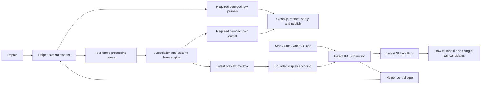

# Live laser diagnostic GUI

Status: experimental functional integration, not calibrated scanning qualification.
Base implementation: `c223a7d26af005c1e49fff0af6d18a22d67aa87e`.
Implementation: `a570c783111c1b6f25d64af8fb08c0f569e23d17`; the documentation binding is a later commit.

## Interface and data ownership

The **Laser candidates → Native laser capture** panel accepts an existing camera
model JSON, explicit stream request JSON and a new output directory. Start opens
a supervised helper. Stop requests journal finalization and save; Abort cancels
processing and retains available partial outputs. The explicit startup equivalent
is `scancraft --capture-laser GEOMETRY STREAM_REQUEST NEW_DIRECTORY`.
The request retains the acquisition API's preserve/default or explicitly scoped
line-boolean policy. This panel adds no arbitrary controls or calibration writes.

`candidate_ui/capture.rs` owns the worker and command state. `laser_process.rs`
supervises a device-owning instance of the same executable; source calls and
settings restoration stay in `scancraft_acquisition::laser::scan`. The parent
performs nonblocking pipe reads and never acquires camera descriptors. Root close
requests Stop and waits for supervision. Failed IPC or explicit Abort retains the
GUI capture guard until actual helper exit. Only application teardown can leave
cleanup unconfirmed, retaining the existing child/reaper policy. Driver/file calls,
thread joins and teardown do not have a hard deadline; SCAN-REV-005 remains open.

`laser_display::Snapshot` contains two raw thumbnails (each at most 320×240),
full-frame statistics, at most 4096 finite candidate positions, source indices,
host timestamps, raw PTS, detector counters and observed raw/drop counts. DTOs
reject unknown fields, invalid dimensions/outcomes/counters and oversized arrays
during decoding. IPC progress is capped at 2 MiB and completion at 64 KiB.
The raw recording and numerical engine retain their existing limits; a pair that
exceeds the display cap is omitted from preview rather than rejected from raw
recording. Preview validation/encoding errors increment omissions independently;
a real write/flush failure requests source cleanup (SCAN-REV-018 principle).

Each helper/GUI mailbox keeps one latest snapshot. Replaced snapshots count as
preview omissions, separately from processing-queue drops and raw rejection
counters. Completion drains the mailbox again after worker completion. The
viewport displays one diagnostic pair, never a fused scan or metric editable
Cloud. Failed startup retains the prior view; later failures retain the latest
available view and report retained staging paths. Unverified units and physical
accuracy remain explicit. Existing raw histograms and display-only contrast stretch
are reused; no reconstruction mathematics changed.

`Pipeline::run_progress` adds observed monotonic source counts while preserving
`run`'s existing callback API. Drops are acquired before recorded counts to preserve
the append-before-drop relationship; counts are not a simultaneous snapshot or
power-loss durability attestation. The bundle preview callback receives the actual
pipeline profiles with its borrowed pair and outcome. Compact NDJSON gains an
additive acquisition-counter field; raw recording format remains unchanged.

## Device-free replay and retained outputs

`scancraft --replay-laser GEOMETRY STREAM_REQUEST FIRST_RECORDING SECOND_RECORDING NEW_DIRECTORY`
uses the same helper/IPC/view with an explicit recording-replay origin. It opens no
scanner. Rewritten recording context explicitly identifies replay and does not
claim a new native capture or verified physical calibration. It reuses indexed
Playback validation, so this diagnostic replay adapter is not a constant-memory
long-recording proof. Native acquisition retains its bounded streaming path.

The native stream bundle remains the format documented in
[NATIVE_LASER_CAPTURE.md](NATIVE_LASER_CAPTURE.md). The existing **Open candidates**
loader accepts older full recorded-matching bundles; it does not yet directly
reopen a stream bundle. Replaying its retained recordings through the explicit
command above restores diagnostic previews into a new bundle. No automatic metric
export, last-pair file conversion, persistent fused model or editable scan project
is implied.

## Validation and limits, 2026-11-03

Confirmed: formatting, strict all-target Clippy, 771 Rust tests and release build
pass. New regressions cover decoding/counter limits, fragmented progress/completion,
optional-display rejection versus BrokenPipe, graceful Stop versus EOF/unknown
controls, delayed helper finalization, malformed IPC/Abort guard retention,
teardown honesty, latest/final previews, actual egui form dispatch, retained prior
view and root close. `tests/laser_process.rs` runs the real helper with synthetic
recordings, verifies raw equality/footer integrity and preview/candidate agreement,
keeps replay labels and checks no-overwrite failure. These are synthetic/process
checks, not hardware accuracy tests.

Private saved-Raptor replay render displays both camera images and 2003 candidate
points. It deliberately runs unpaced: all 16 frames/camera remain saved, with only
3 pairs processed and 13 processing drops/camera. This is not throughput evidence.

Two native GUI starts with the private Xvfb software renderer's default thread
configuration accepted zero frames and failed on incomplete/error-flagged buffers
and camera poll timeout. They retained failure diagnostics; source cleanup and
restoration reported success. The first trial's full before/after stream and
illumination readbacks match; the second trial's pre-state equals the subsequent
headless pre-state. Those failures are retained, not excluded from qualification.
The scanner negotiated a 5000-Mbit/s USB link. A separate CLI control succeeds at
30 FPS, and a headless app helper saves 32 frames/camera, processing 19 pairs.

With the private software-renderer environment `LP_NUM_THREADS=2`, a native GUI
finite trial saves **32 frames/camera, processes 19 pairs**, has 13/12 processing
drops and 1873–2104 candidates/pair, with no pair processing failures. An actual
window-close-during-acquisition trial saves **7/7 raw frames and 6 pairs**, restores
settings and exits; one observed close-to-exit time is 0.338 s. Both trials pass
raw replay/integrity and exact before/after stream plus illumination readbacks;
original line property 151 is restored. Screenshots show raw images, live status
and single-pair candidates, with the GUI holding no device descriptors.
The initial helper-FD sampler inspected only the GUI main thread's children and
therefore missed children spawned by its monitor thread; no positive helper-FD
observation is claimed from that sampler. Device ownership is explicit in the
source/helper boundary; broader live descriptor sampling remains follow-up work.

The renderer condition correlates with success in these observations; rendering
load/startup contention is an **engineering hypothesis**, not an isolated causal
proof or application fix. No production renderer settings, OS priorities or frame
validity guards were changed. Default-renderer robustness still needs investigation.
The 19/32 processed fraction is below the 90% provisional target. No 20-FPS preview,
p95 latency, cold-start, memory-soak, driver deadline or full workflow pass is claimed.

All 49 compact reports / 95,833 candidate values across CLI, headless native,
finite GUI, close GUI and replay bundles are checked separately against the same
engine reading retained frames; every frame reference's CRC, sequence, flags,
time and PTS matches. All five manifests' artifact lengths/CRCs match. All 19
headless native IPC preview packets exactly match saved positions, cameras,
acquisition counts and frame references. This is same-engine integrity/regression
evidence, not independent geometric truth. Calibration/units, optical coverage,
tracking/fusion, reliable sustained scanning and qualified models remain incomplete.

Private data, model, screenshots, logs and probe source stay outside Git under the
developer state directory. Recovery checkpoint records source/binary SHA bindings,
exact commands and evidence manifest. CodeRabbit 0.9.2 still returns
`lookup_failed` for included quota and billing; review/publication remain pending.
No paid review, firmware change, physical calibration or merge was performed.

## Implementation provenance

The new supervision/UI code is independently written project code adapting existing
OwnedChild, private-log, nonblocking protocol, Worker, candidate viewer and
raw-journal ownership patterns. Mathematical processing calls existing Rust laser
modules; no upstream algorithm or proprietary implementation is copied. App/image
add direct edges to the already pinned serde dependency (MIT OR Apache-2.0), with
no new external package or license change. See Cargo manifests/lock and the files
named above for reproducible source boundaries.
