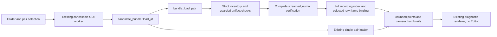

# Reopen saved laser captures

Completed native and replay captures can now be reopened in **Laser candidates**.
Enter the capture folder, select **Pair** (numbered from one), and click **Open
candidates**. After a successful capture, the form is populated with its saved
folder and last pair. Each view contains one stored pair's diagnostic points and
its retained camera images. Tracking, fusion, metric editing and a complete scan
project are separate unfinished work.

```sh
# Command-line indices start at zero: this opens the 28th processed pair.
target/release/scancraft --laser-candidates /path/to/capture 27
target/release/scancraft-cli inspect-laser-capture /path/to/capture 27
# Verify every pair and print only a final summary.
target/release/scancraft-cli inspect-laser-capture /path/to/capture --all
```

Omitting the GUI startup index selects the first pair. Existing single-pair
matching folders remain supported at index zero / Pair 1. The CLI inspector
accepts completed capture folders and prints the verified view summary, without
dumping raw pixels or starting acquisition. SIGINT/SIGTERM request cancellation.

The [sequential reader](LASER_CAPTURE_SEQUENCE.md) reuses the raw indexes for
all-pair inspection; its provisional callbacks require staged consumers. The
single-pair verification scope described below remains unchanged.

## Architecture and verification boundary



`laser_stream/bundle/load.rs::load_pair` reuses `Plan::open` to validate the retained
geometry/request; it never calls capture, target admission or a device adapter.
`verify_artifacts` checks the fixed layout, unique allowlisted roles, bounded
regular files, declared lengths/CRCs, and exact directory contents. The existing
streamed `pair_journal::visit(Complete)` checks all journal records, order, segment
and manifest digests and completion. Request/index quotas and report/journal counts
must agree. Symlinks, traversal roles, extra failure/staging artifacts, corruption
and incomplete captures are rejected. Existing recovery inspection remains a
separate read-only command and does not produce a successful view.

The two full bundled recordings are CRC-checked and indexed with the existing
`Playback`; footer integrity, counts and profiles must agree with the report and
request. The selected record must match its raw sequence, flags, timestamps,
payload/metadata CRCs, sensor PTS and allowed host window. Per-record acquisition
counters, when present, must fit the final source counters. The selected points
and query outcomes must have consistent counts, finite coordinates, unique and
valid references. Physical/model qualification assertions remain false.

`load/record.rs` deserializes only a bounded display subset: at most 4,096
candidates/outcomes and 100,000 declared observations per camera. Unused matching
fields are skipped without allocating a complete JSON value tree. The shared
`bounded_json::Items` is the existing single-pair loader's implementation moved
without changing its bounds or behavior. At most 262 manifest artifacts cover the
256 supported segments plus fixed metadata/raw files. Existing recording index,
record-byte and parser limits still apply; excessive input fails instead of being
silently sampled.

Guarded path/open-file identities are rechecked after frame preparation and before
return. GUI application is transactional: failure or cancellation retains the
previous images, points and **actual displayed pair label**, even when the requested
pair number changes. A stored numerical-processing failure can be viewed as an
explicit error with retained images and empty candidate geometry.

The loader does **not** recompute numerical matching, verify every other pair's
raw-frame linkage, authenticate the capture, attest current scanner state, establish
physical synchronization or qualify dimensions. Artifact CRCs describe accidental
integrity, not authenticity. Restoration is a recorded claim. Earliest schema-1
reports omitted `reported_source_restoration`; they load with that information
explicitly unknown. An explicit failure is rejected, and schema 2 still requires
the field. No missing metadata is promoted to successful restoration.

Complete here describes the current bundle structure and checked bytes. It does
not prove that the original capture call returned success or that storage survived
power loss; a post-publication parent-directory sync error can leave a fully formed
folder. Opening that folder does not certify durability or promote it to a project.

Loading and changing pairs currently reverify the complete capture and index both
recordings: I/O is linear in capture size. One selected report, bounded thumbnails
and positions are retained, alongside existing bounded recording indexes and file
identity guards. Large-session time, descriptor pressure and whole-app RSS remain
unqualified. File I/O and bounded parsing are cooperative, without a hard deadline.
No lazy-cache performance claim follows from small captures.

## Provenance and compatibility

Baseline `8ebaf26265cfc5ac83088b02d7b50209f088081c`. New validation and adapters are
independently written Rust under the project license. They reuse existing
Guard/Playback/journal/FrameView components and serde_json; no external algorithm,
third-party source, dependency, unsafe code, firmware or calibration change is
introduced. The legacy seven-artifact single-pair loader remains intact behind
the routing wrapper. Existing device, helper IPC, numerical and capture formats
are unchanged.

The design reads stored results so reopening reproduces what was recorded rather
than silently running a newer reconstruction algorithm. Reprocessing remains an
explicit operation with a new output. Diagnostic views stay outside the metric
Editor because physical model/units are still unqualified.

## Validation evidence

Final formatting, strict frozen all-target Clippy, **824 tests** and release builds
pass; the existing >1 GiB capacity test remains explicitly ignored in the default
gate and was validated in the preceding storage milestone. Eight new workflow
regressions cover both layouts/pair selection, immutable inputs, references and
counters, false qualifications, corruption, unsafe layouts, partial recordings,
early/late cancellation, final mutation, stored processing errors, typed array
limits and historical metadata. App tests cover startup indices, completed-capture
presets and preservation of a prior pair label after failed opening.

A release-library probe opens nine retained older folders (single-pair, schema 1
and schema 2): **18 selections / 26,750 point values** preserve every position,
observation index and complete serialized FrameView against stored results and
selected raw frames. SHA-256 checks preserve all **129 original input files**.
This is format/display consistency, not independent geometric truth.

Final native GUI capture saves **32 raw frames/camera and 28 pairs**, drops 3/4,
pending 1/0, startup rejects 82/102 and ongoing rejects 1/1. An active close saves
9 raw frames/camera and 9 pairs, zero drops/pending, startup 81/2, ongoing 0/0 and
one stopped incomplete buffer/camera. One close-to-exit observation is 0.326171 s.
Both pass raw integrity/publication and full stream/illumination GET restoration;
helpers own scanner descriptors and the GUI owns none. The 87.5% finite processed
fraction remains below 90%; startup rejects and all physical/duration gates remain
open. Preliminary native trials are retained separately.

Actual application restarts reopen the legacy single-pair folder, earliest capture,
last pairs of both new captures, and a browsing capture. Real private-display input
changes Pair 1 to Pair 2, then requests an invalid pair: the error preserves Pair 2's
images, 1,945 points and source label. All five final read-only application instances
exit normally and hold no scanner descriptors. Saved, legacy, selected and failed
views were inspected. An earlier GUI harness timed out waiting for agent input;
it closed normally. The passing retry supplied its interactions automatically;
the timeout and screenshots are retained, not represented as an application failure.

The final CLI inspector opens an older 61-pair capture's last pair: 1,915 points
bound to raw frames 63/63. Actual SIGINT/SIGTERM tests observe installed handlers,
return exit 1 with cancellation and no partial summary; this is not a deadline
qualification. The frozen earlier engine/serializer verifies all four preliminary
and final native bundles: **74 records / 138,873 candidate values**, exact raw
references and complete old record bytes. All four manifests pass lengths/CRCs.
Final accessible scanner-FD inventory is empty. Authenticated private X11 readiness
and LP_NUM_THREADS=2 software rendering remain explicit test conditions.

Private source/binary bindings, raw inputs, tests, failed attempts and screenshots
remain in developer recovery artifacts `saved-laser-capture-6fj_s2ox`, excluded from
Git/review uploads. Initial checks caught an OsString parser error, an oversized
array fixture reaching its byte cap first, missing historical restoration metadata,
and one strict Clippy expression; all were corrected with their logs preserved.
CodeRabbit quota/billing lookup remains unavailable; no automated review pass,
paid usage, push or merge is claimed. Independent review is pending. Findings
005/006/007/021, calibrated reconstruction, tracking/fusion, sustained performance
and the complete editable scan-to-model release remain incomplete.
