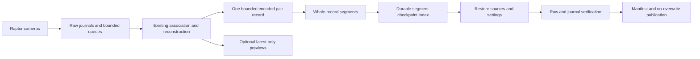

# Segmented laser pair journals

Schema 2 adds bounded, indexed pair-log segments to the existing native and replay
laser capture paths. It addresses the storage constraint in SCAN-REV-024 without
changing reconstruction math, optional preview policy or raw recording formats.
This is experimental storage infrastructure, not sustained-scan or geometric
qualification. The independent reviewer controls the finding's disposition.

## Request compatibility and admission

`laser_stream/bundle.rs::Plan::open` retains schema 1's single `pairs.ndjson`,
4 KiB–1 GiB total pair quota, successful record bytes and manifest/report schemas.
Schema 2 requires three additional unsigned fields; omission or explicit null is
rejected. Supplying these fields to schema 1 is rejected, including null.

| Field | Meaning and bound |
| --- | --- |
| `maximum_pair_log_bytes` | Sum of segment bytes, 4 KiB–256 GiB |
| `pair_log_segment_bytes` | Maximum bytes per segment, at least the record limit and at most 1 GiB |
| `maximum_pair_record_bytes` | Maximum complete JSON record including newline, 1 KiB–8 MiB |
| `maximum_recording_bytes_per_camera` | Existing per-camera raw quota, at most 1 TiB |
| `maximum_bundle_bytes` | Declared aggregate budget, at least twice the raw quota plus the total pair quota plus 8 MiB metadata; at most 3 TiB |

At most 256 segments are admitted. To conservatively accommodate fragmentation,
`maximum_pair_log_bytes` must be no greater than
`256 * (pair_log_segment_bytes - maximum_pair_record_bytes + 1)`.
This sacrifices some possible capacity for a static slot guarantee. Index and
bounded metadata fit within the separate overhead allowance; no observations are
sampled or truncated to fit a record. An oversized record or exhausted quota fails
the required journal and prevents successful capture publication.

Schema 2 also admits every configured raw frame against its camera quota using
payload pixels, 4096 metadata bytes and framing, plus maximum header/footer space.
It does not predict pair-record size from scene complexity: record/total quotas
remain runtime limits. A large frame count alone does not guarantee duration.

`Plan::admit_target` and `bundle/log.rs::admit` require a new target and use
`fstatvfs` on a held parent-directory descriptor. Available bytes must cover the
bundle budget plus 64 MiB headroom. Native acquisition performs this check before
its device lock, scoped illumination lease or source opening. This is an available
space snapshot, not a reservation, filesystem user-quota check or guarantee against
concurrent disk consumption. Later I/O failures still fail publication and retain
available failure evidence. No hardware settings change follows admission failure.

## Data flow and persistence



`pair_journal/write.rs::Journal` serializes at most one bounded record, with
cooperative cancellation checks around encoding and at serializer-write intervals.
Records are never split between files. Successful append flushes a complete record
before optional preview handoff. Segment names are derived fixed roles such as
`pairs-000000.ndjson`; no user-supplied segment paths are interpreted.

On rollover, the writer finishes/fsyncs the old segment and syncs its directory,
then appends/fsyncs the index checkpoint before creating the next segment.
`pairs.index.ndjson` has a strict version-1 header with limits, ordered segment
entries (number, first pair, count, bytes, CRC32), and a completion footer binding
counts and the preceding index bytes/CRC. The index is capped at 1 MiB; each index
line is capped at 4096 bytes when read. CRC detects accidental corruption; it
provides no authenticity guarantee.

Writer state retains at most 256 digests and one encoded record, plus fixed I/O
buffers. It retains no session-wide pair history. This bounds journal state, not
the application's total resident memory. Filesystem guards retain descriptors
for checked files; finalization has O(segment count) descriptors and rereads data.
Bundle digest verification and journal semantic inspection are separate passes.
Complete-mode manifest lookup also repeats bounded parsing per segment; maximum
segment-count finalization latency and descriptor pressure remain unbenchmarked.

An I/O/serialization/cancellation error poisons the writer; finish cannot return
success. Pending buffers are explicitly discarded on failure/drop rather than
retried by destructor writes. A final fsync failure can leave a readable completion
footer: **a structurally complete journal does not prove durable storage, successful
capture, raw restoration or successful bundle publication**. The final-sync
regression deliberately verifies this distinction. Source close/restoration,
raw readback, digest checks and no-overwrite publication remain mandatory.

Schema-2 report/manifest versions are 2. The report adds `pair_journal` with format,
index role, segment count, pair count and bytes. Per-pair records stay schema 1;
the raw recording format, reference roles and numerical result format are unchanged.

## Read-only inspection and crash prefixes

```sh
scancraft-cli inspect-laser-journal DIRECTORY
scancraft-cli inspect-laser-journal DIRECTORY --recovery
```

`pair_journal/read.rs::visit` streams one bounded pair record at a time. It checks
index/footer order, counts, quotas, bytes/CRC, derived filenames, pair reference
ordering and basic acquisition counters. It rejects symlinks, malformed records,
ambiguous layouts and detected source mutation. Complete mode additionally checks
journal artifact digests if a bundle manifest exists. A legacy complete inspection
requires the manifest digest; legacy recovery can inspect an unverified prefix.
Legacy inspection itself has an 8 MiB per-record safety limit, even though older
schema-1 writers did not impose that individual-record bound. It therefore does
not promise to inspect every theoretically valid historical giant record.

Recovery mode accepts checkpointed segments and at most the next unindexed segment,
with a valid complete-record prefix and an optional non-newline-terminated tail.
A newline-terminated malformed record remains an error. Recovery ignores a possibly
torn bundle manifest and still checks journal structure/checkpoint CRC. Torn index
bytes and final record bytes are counted together as `trailing_incomplete_bytes`.
It never edits, truncates, repairs, renames or publishes the input. Raw recording
prefix recovery remains a separate `recover-recording` operation.

Visitor results are provisional until the entire visit returns success: a later
CRC or identity check can invalidate earlier callbacks. A caller must not publish
from callbacks. `journal_complete` describes observed structure only, and
`source_restoration_verified` and `physical_accuracy_qualified` are always false.
The reader skips numerical results during header validation; it does not establish
result correctness, raw-frame linkage, simultaneous exposures or calibrated units.

## Verification and remaining work

The full Rust gate passes 791 tests with one explicitly ignored capacity test:
formatting, strict frozen all-target Clippy, workspace tests and release build.
Journal tests cover exact bytes, rollover, cancellation, record/total/slot limits,
file creation/write/sync failures, retained prefixes, CRC/footer corruption,
symlinks, order regression, torn manifests and mid-read mutation. Bundle tests
exercise paced synthetic multi-segment capture, preflight rejection before source
opening and required-journal failure cleanup. An actual helper-process synthetic
schema-2 test preserves raw data and candidate IPC.

The separately executed ignored release test writes and verifies 9000 synthetic
records totaling **1,182,790,236 bytes in 71 segments**, above the former 1 GiB cap.
These records contain synthetic error strings, not hardware geometry. This proves
that bounded segments can exceed the old total limit; it is not a 30-minute scan,
a 60-minute memory soak or a live-rate benchmark. A separate direct invocation of the release test executable takes 3.62 s with
5740 KiB maximum RSS in one observation. That excludes compilation and includes
synthetic serialization, I/O/cache behavior and reader validation; it is not a
whole-application memory bound or controlled throughput comparison.

Short native GUI tests use the existing authorized scoped line lease and an
isolated software-renderer condition (`LP_NUM_THREADS=2`). Finite capture saves
32 raw frames/camera and 21 pairs into 21 segments (22,530,100 pair bytes), with
11 processing drops/camera and no unmatched input: 65.625%, below the 90% gate.
There are startup buffer rejects 1/1 and ongoing 0/0, separately reported. The
close-during-acquisition trial saves 9 raw/camera and 7 pairs in 7 segments, with
2 processing drops/camera, startup rejects 1/0, ongoing 0/0 and one stopped
incomplete buffer/camera. One observed close-to-exit time is 0.280 s, not a bound.
Both trials pass raw integrity/publication/restoration and exact full before/after
stream/illumination GET readbacks. Helper camera descriptors are observed; GUI
camera descriptors are absent. All observed app/helper processes exit.

Unpaced replay retains all 32 raw frames/camera, processes 4 pairs into 4 segments
and reports 28 processing drops/camera; four preview packets and completion arrive.
Across three prior legacy and three new bundles, 65 complete pair records / 123,278
candidate values match the unchanged engine and original serializer byte-for-byte,
including every raw-frame CRC/sequence/flags/time/PTS reference. All new manifest
lengths/CRCs pass. A real-data crash-prefix copy with a torn manifest recovers one
indexed and one unindexed complete record plus 128 trailing bytes; strict mode
rejects it and inspection leaves all source hashes unchanged. These are integrity
checks, not independent physical truth. Private input/model/screenshot/probe data
remain outside Git and review uploads.

Required follow-up includes sustained resource/failure qualification, measured
finalization at maximum supported segment counts, practical disk-budget UI,
calibrated geometry/coverage, tracking/fusion and editable model retention. The old
IR session-capacity issue SCAN-REV-021 is separate and unchanged. No new dependency,
copied upstream algorithm, firmware update or physical calibration is introduced.
