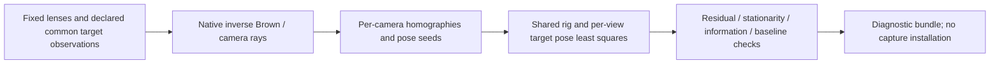

# Fixed-intrinsic stereo calibration

Experimental, software-only fitting of supplied observations. This stage jointly
optimizes `right_from_left` and all target poses while **holding both supplied
lens models fixed**. It does not jointly refit lens parameters or establish Raptor
optical binding, exposure synchronization, physical accuracy or calibration coverage.
Physical calibration remains deferred; no camera is opened or configured.

## Native interfaces and data flow

- `scancraft_calibration::stereo_fit::fit_stereo_extrinsics`: numerical fit.
- `scancraft_workflow::stereo_calibration::run`: bounded request and diagnostic bundle.
- `scancraft-cli calibrate-stereo-extrinsics OBSERVATIONS_JSON NEW_OUTPUT_DIRECTORY`.



Schema 1 requires `provenance` (`synthetic_fixture` or `user_supplied_unverified`),
`fixed_left`, `fixed_right` (existing CameraModel schema), `views`, and `fitting`
(`max_iterations`, `max_reprojection_error_px`). Each view has `observations`;
each observation has `target_xy_mm`, `left_pixel`, `right_pixel`. A single record
identifies one target coordinate in both cameras; unrelated array lengths cannot
silently associate different points. Incorrect labels or moving targets can
still produce a misleading fit: common pose/correspondence is a caller declaration,
not physical attestation. Lens radius and provenance are likewise supplied claims.

Camera axes are +X right, +Y down, +Z forward. Target `[X,Y,0]` and translations
are millimeters. `p_right = R_right_from_left * p_left + t_mm`. The right camera
origin in left axes is `-R.transpose() * t`. Target poses are `left_from_target`.
Changing declared board scale changes translations; a low pixel residual cannot
certify dimensions or physical units. Swapping cameras must invert the rigid pose.

## Method, provenance and design rationale

Independent MIT Rust implementation. No upstream source, vendor implementation,
paper assets or calibration data were copied. [OpenCV stereoCalibrate](https://docs.opencv.org/4.13.0/d9/d0c/group__calib3d.html)
with `CALIB_FIX_INTRINSIC` is the numerical reference and method boundary. Its
documentation recommends separate accurate lens estimation when available; this
stage complements the existing native Brown5 mono fitter. It is not a claim that
supplied Raptor intrinsics are known or that simultaneous lens/rig optimization is
implemented. No speed or accuracy advantage over mature software is asserted.

1. Validate fixed lenses and bounded per-view correspondences. Native inverse
   Brown projection maps pixels to normalized rays. Normalized DLT and existing
   SO(3) pose recovery estimate a target pose in each known camera.
2. Each pair of target poses yields a relative transform. Project the mean relative
   rotation to SO(3) by SVD and average relative translations for an initial rig.
   This is a seed, not the final fit or a robust averaging algorithm.
3. Jointly minimize all left/right squared pixel residuals. A shared six-parameter
   rig couples independent six-parameter target poses. Analytic derivatives use
   `R'=exp(dw)R, t'=t+dt`, with each increment in its transform's output frame.
4. Shared block normal equations eliminate target poses into a 6×6 Schur system.
   Cholesky solves/back substitution optimize rig and target poses together.
   This is local least squares without robust loss or automatic outlier rejection.

`projection_differential.rs` now shares Brown projection/point/pose derivatives
with mono fitting. `normal_blocks.rs` shares damping, Schur solve, scaled gradient
and information checks for six or ten global parameters. There is no full dense
observations-by-all-parameters Jacobian; the small rank diagnostic uses a bounded
6×6 or 10×10 dynamic matrix copy. Independent dense-system tests cover both layouts.
The [Ceres documentation](https://ceres-solver.readthedocs.io/latest/nnls_solving.html)
describes the standard Schur concept; solver code was not imported. Existing
Apache-2.0 nalgebra 0.35.0 remains the algebra backend. Dependencies, versions,
licenses and mandatory native runtime requirements are unchanged.

Workflow `calibration_bundle.rs` shares exact-byte retention, checksums, staging,
fsync and atomic no-overwrite publication with the mono tool. Its existing public
provenance type path is re-exported unchanged. The previous mono synthetic reference
fixture and all three release-CLI artifact sets reproduce byte-for-byte after this
extraction. That is a scoped regression result, not a proof for every possible input.

## Bounds and rejection policies

The API accepts 3–64 declared target poses, each with 4–4096 observations. Fixed
camera dimensions are positive and at most one million per axis. Coordinates must
be finite; target coordinates stay within ±1e9 mm and pixels within each camera's
existing bounds. Duplicate/collinear targets, invalid fixed models, unsupported
lens-domain observations and bad homography rank fail. Different camera sizes,
Brown coefficients and skew are supported. With known intrinsics, repeated views
can constrain a rig; this does not prove useful calibration coverage.

At most 100 iterations (default 80), each with at most 16 damping trials. Trials
must strictly decrease finite cost. Final scaled gradient must be <=1e-6 and
scaled pose-eliminated information minimum eigenvalue >=1e-10. Every final
individual camera residual must meet the supplied limit. Baseline must satisfy the
existing nonzero stereo requirement (>1e-9 mm). These are numerical policies, not
physical acceptance thresholds, covariance or global-optimum guarantees. Normal-equation conditioning and large target offsets can cause conservative
rejection. No uncertainty estimate is provided.

Cancellation latches once observed and checks per view, every 256 observations and
each trial. CLI SIGINT/SIGTERM uses existing scoped handlers. File I/O and bounded
SVD/inverse-projection calls are not forcibly preempted; no whole-command shutdown
deadline or resolution of SCAN-REV-005 is claimed.

The JSON workflow requires a regular file <=16 MiB and rejects unknown fields. It
retains exact `observations.json`, `fit.json` and CRC-checked `manifest.json` in a
new directory. `intrinsics_fixed` is true; device binding, synchronization and
physical accuracy flags are false. Input/existing output are preserved. Failures
before staging publish nothing; write failures retain the named partial folder;
post-publication parent-sync failure says the bundle is already published. CRC is
not authentication. No RAPCAL01 record, project import or capture installation is
performed, and mono fitter output is not automatically given a qualified lens domain.

## Reproduction and evidence

```sh
cargo run --frozen --release -p scancraft-calibration --example stereo_fit_reference > /tmp/stereo-fit-cases.json
python3 -m venv /tmp/stereo-fit-reference-venv
/tmp/stereo-fit-reference-venv/bin/python -m pip install -r tools/reference-requirements.txt
/tmp/stereo-fit-reference-venv/bin/python tools/compare_stereo_fit_opencv.py /tmp/stereo-fit-cases.json /tmp/stereo-fit-comparison.json
python3 - <<'PY'
import json
from pathlib import Path
case = json.loads(Path('/tmp/stereo-fit-cases.json').read_text())['cases'][2]
Path('/tmp/stereo-observations.json').write_text(json.dumps(case['request']))
PY
cargo build --frozen --release -p scancraft-cli
target/release/scancraft-cli calibrate-stereo-extrinsics /tmp/stereo-observations.json /tmp/new-stereo-fit
tools/check.sh
```

Six stereo tests cover exact distorted/skewed/asymmetric rigs and target poses,
all twelve derivative columns, noisy joint optimization/individual limits,
metric scaling/camera inversion, cancellation/nonconvergence and invalid data,
collinearity/duplicates/bad pairing/domain/zero baseline. Shared Schur solve is
checked against a full dense system for six/ten globals and three damping values.
Two stereo workflow tests complement the existing mono publication regressions.
The full frozen gate passes **607 Rust tests**, formatting, strict Clippy and
release build. An initial type-complexity lint was corrected with semantic aliases,
without weakening lint configuration.

Three independent synthetic cases each have eight views ×63 points, plus twelve
held-out 3D points. OpenCV 5.0.0 fixed-intrinsic stereo calibration compares zero-skew
cases with float32 observations. Nonzero skew is checked against known truth and
NumPy projection, not unsupported OpenCV skew behavior. NumPy recomputes all
residuals; existing native triangulation checks held-out points generated from the
known fixture rig. No target was physically captured or calibrated.

On the noisy fixture, RMS changes from 0.020412 to 0.018714 pixels; relative
translation differs from OpenCV by about 0.0000062 mm. Held-out synthetic
triangulation error is about 0.0298 mm. These numbers are neither scanner accuracy
nor real exposure/reliability results. Altering the fitted relative translation
makes the independent checker reject inconsistent residuals. The release CLI
reproduces all three fits, preserves fixed models/inputs/existing output and
rejects unknown fields. Source/log/fixture/runtime hashes and exact thresholds
are in `reviews/evidence/2026-10-27-stereo-calibration-reference.json`.

Simultaneous lens/rig optimization, target detection/subpixel localization,
robust selection, coverage/uncertainty, actual Raptor source/mode/optical binding,
synchronization, dimensional accuracy and hardware qualification remain incomplete.
SCAN-REV-006 remains under independent review; this software progress does not close it.
