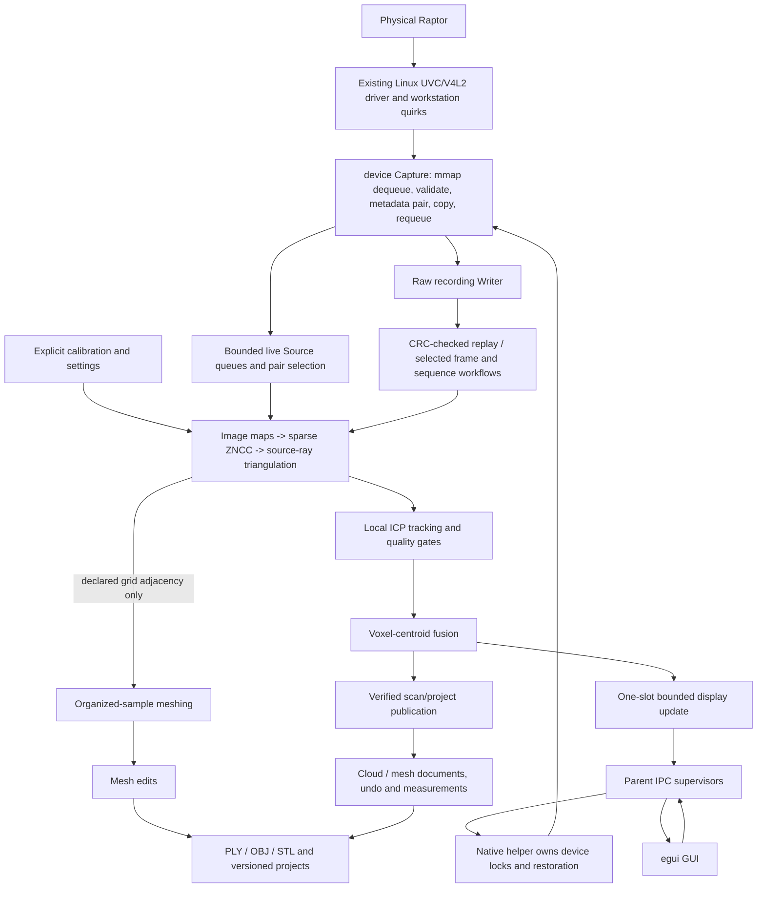

# Audit snapshot

Audited source: `ced7697fa0a4e2a262ae255efffa53ca577f117f` (ScanCraft, formerly OpenRaptor), frozen on 2026-10-27.
This is a developer-authored source audit, not independent reviewer sign-off.
Audit changes are reports and developer-owned review-response documentation;
application code and reviewer-owned files are unchanged. Existing design records
are inspected rather than rewritten. **Confirmed** means inspected source or
an identified record; **Inference** means engineering interpretation;
**Recommendation** means proposed work, not an authorized implementation.
Historical evidence is identified separately from tests rerun during this audit.

# Architecture and data flow

## System boundaries

**Confirmed:** Twelve Rust workspace crates are present. Their manifests, module
inventory below and `Cargo.toml` are the authoritative map. The opening six-crate
list and “future crates” paragraph in `ARCHITECTURE.md` are historical and no
longer a complete current map. This audit does not silently rewrite that record.

| Crate | Responsibilities and entry points | Principal boundaries |
|---|---|---|
| scancraft-core | StreamProfile, Frame, validate_frame, UVC PTS/metadata validation | Owned raw bytes; no GUI/device descriptors |
| scancraft-device | discover, Capture, SessionLock; control, stream_group, scr_observations | Linux sysfs/V4L2 mmap/ioctl/poll; settings and restoration |
| scancraft-recording | Reader/Writer; context, recovery, indexed playback | CRC-backed raw records and bounded decoding; no reconstruction |
| scancraft-calibration | CameraModel, PreparedStereo, rectification; planar/refinement/stereo_fit; factory_* | Optical math and diagnostic decoding; storage validates declarations, not physical truth |
| scancraft-image | GrayImage/MaskedImage, UndistortMap/StereoImageMaps, laser, corners | Sampling/stripe and seeded corner measurements; geometry WorkControl dependency |
| scancraft-depth | reconstruct, matching, StereoProcessor | Sparse correspondence, source-coordinate triangulation and reports |
| scancraft-geometry | Cloud/Editor, spatial, registration, tracking, fusion, session; mesh/measurement modules | Millimeter geometry, histories, fitting, editing and formats |
| scancraft-workflow | prepare/publish_prepared; live_stereo; recording/project bundles; offline calibration | Device-independent jobs, bounded inputs, provenance and atomic output |
| scancraft-acquisition | scan, Native adapter | Owns Capture/settings lease; supplies workflow Source implementations |
| scancraft-app | eframe App, cloud/mesh/live UIs; capture/live/discovery_process | GUI, background jobs and same-executable helper supervision |
| scancraft-cli | main dispatch and diagnostic adapters | Native capture plus device-independent workflow commands |
| scancraft-usb | optional hardware-experiment feature | Separate nusb experiment; not the default app transport |

There is no implemented general-surface edge from an unorganized fused cloud
to the organized-grid mesher; that branch requires explicitly retained sample
adjacency. The geometry-producing paths exist in source; the diagram is not proof of a
qualified physical end-to-end scan. `depth::pipeline::StereoReport` deliberately
keeps synchronization/physical qualification false. `ACCEPTANCE_RESULTS.md` and
`README.md` distinguish real structural acquisition from calibrated geometry.

## Acquisition, concurrency and shutdown

`device::Capture` uses Linux UAPI bindings and owned mappings/descriptors. Kernel
buffers are copied while dequeued, then requeued; raw Frame values cross thread
and process boundaries. SessionLock prevents cooperating captures from racing.
`acquisition::scan` obtains a group SettingsLease, invokes the workflow runner,
and combines operation/restoration errors. It does not write firmware or install
calibration. Native capture currently depends on the documented workstation UVC
patch/permissions; stock-kernel installation is unqualified (`README.md`).

`app::capture_session::run` records validated frames before display delivery and
explicitly closes capture before final recording publication. `capture_process`
and `live_process` place device ownership in child processes. Parent supervisors
use nonblocking bounded read batches; ordinary Stop and abort have different
semantics. Completion requires a validated final message, pipe EOF and successful
child exit. An abort timeout reports cleanup unconfirmed, retaining the child's
locks/restoration duties; the reaper waits without owning the scanner. No kill or
reset is used. `discovery_process` similarly isolates read-only QUERYCAP; normal
cancellation and failed IPC retain the pending guard until actual child exit.

GUI preview has a two-frame channel; full queues count display drops. Native live
progress uses a one-slot mailbox, at most 50,000 preview points and bounded
thumbnails/16 MiB progress packets. A rejected display payload is omitted, while
actual pipe failures abort. These bounds are transport/display policies, not
measured FPS guarantees (`capture_ipc`, `live_process`, control/display.rs).

**Inference:** remaining latency/memory risks include synchronous storage and
publication, setup/restoration ioctls inside the helper, raw-frame copies, JSON
cloud serialization and per-job/document snapshots. Device isolation prevents
GUI joins from directly owning a stuck ioctl but does not bound spawn, filesystem,
scheduling, allocator or all application Drop behavior. Independent SCAN-REV-005
remains Open; physical stall/disconnect qualification is absent.

## Live-session capacity constraint

**Confirmed:** `live_stereo::Processor::open` and `Association::new` accept at most
1,000 frames per camera. `runner::record_controlled` stops each source after its
configured maximum, `verify_recording` rejects more than 1,000, and
`geometry::live_references::LiveSession::validate` caps both recorded-frame counts
and pairs at 1,000 plus a 1 MiB serialized-reference limit. `ScanSession` has its
own separate 100,000-frame history cap. A per-pair JSON file, in-memory pair/report
vectors, complete recording replay and artifact fingerprinting all participate
in publication. Raising one number alone cannot make a long session publishable.

A later device-free probe against unchanged audited Rust source verified that
both `Association::new` and `Processor::open` accept a synthetic configuration
at 1,000 and reject 1,001. No scanner or physical calibration was accessed. The
probe and its source/binary hashes are retained in private developer artifacts;
this is a software capacity check, not a timed physical scan. See
PERFORMANCE_AND_VALIDATION.md for duration/disk arithmetic and its assumptions.

## Geometry, editing and rendering

Image maps precompute inverse sampling with validity masks. Stereo maps can apply
one image on a scoped helper and one locally, falling back to sequential work.
Matching is sparse bounded ZNCC with uniqueness/reverse consistency and optional
quadratic disparity refinement; this is not dense SGM. Matches are mapped back
to original cameras before checked ray triangulation (`depth/pipeline.rs`).
Laser row centroids and quadratic-sheet intersections exist as separate diagnostic
primitives; stripe identity, physical mode and camera binding are not inferred.

Tracker selects point-to-point, point-to-plane or Huber point-to-plane ICP, gates
RMS/overlap/pose increments, and does not integrate rejected frames. Session state
supports pause/resume/stop and local loss/reacquisition logic. No inspected module
provides descriptor-based global relocalization, loop closure or trajectory graph
optimization (`tracking.rs`, `session.rs`, `fusion.rs`). Fusion is explicitly
voxel centroids, not TSDF. Mesh generation triangulates declared organized grid
adjacency; arbitrary-cloud Poisson/ball-pivot/volumetric reconstruction is absent
(`mesh::from_grid`, workflow/stereo_surface.rs).

Cloud/mesh jobs preserve owned documents and operate off the GUI event thread.
The geometry editor stores original/current clouds and bounded history; selection
keeps full-resolution indices while the viewport draws sampled data. Selection
includes box, plane, screen rectangle/polygon/lasso/brush with through/frontmost
semantics; editing has preview/cancellation/undo boundaries. Mesh modules provide
imports, topology, components, boundaries, selective planar filling, smoothing,
constrained shortest-edge simplification, orientation and vertex-fan splitting.
They are not a complete arbitrary-mesh repair or precision-surface package.

The app uses eframe's **glow** backend (`app/Cargo.toml`), egui painter/UI geometry
and CPU projection/selection (`cloud_ui`, `screen_tools`, mesh_ui). GPU graphics
presentation does not imply GPU point-cloud processing. No production compute
shader dispatcher or explicit application SIMD kernel was identified. wgpu in
Cargo.lock/notice inventories is not evidence that the chosen GUI enables it.

## Persistence and interfaces

Recording writers use RAPTOR02 with bounded header/frame lengths, CRC and count
footer; RAPTOR01 remains readable. Editable cloud projects accept ORPROJ02 through
ORPROJ08 and retain compatible histories/provenance (`geometry/formats.rs`).
Calibration storage is separately versioned; validating binding metadata does not
qualify optics. Source/recording/sequence/live references persist through relevant
project workflows, and copied containers verify retained artifacts. Native app
and CLI share workflow code instead of separate geometry implementations.

PLY cloud interchange and OBJ/STL mesh paths are implemented. Complete PCD/XYZ
and GLB/glTF interchange was not found in inspected format/CLI modules. Atomic
no-overwrite publication and retained partial outputs protect originals; CRC32
is accidental-integrity evidence, not authentication. Full model/source/session
self-containment varies by project/container type; see workflow modules and
recording_reconstruction integration tests rather than assuming every project
embeds all raw scans.

## Architectural pressure points

**Inference:** geometry owns generic WorkControl, coupling image/depth and device-
independent workflows to a broad crate (independent SCAN-REV-007). UI and workflow
facades are large; many geometry modules are separated but share Editor/history
and publication invariants. Native process supervisors duplicate some lifecycle
policy. Adding FFI without an explicit owned-data/job boundary could undermine
cancellation, error ordering and source provenance.

**Recommendation:** preserve working numerical modules and public contracts;
measure pipeline stages and qualify hardware before broad crate extraction,
FFI replacement or editing expansion. See RECOMMENDATIONS.md.

## Complete Rust source-module inventory

Every tracked `src/**/*.rs` module at the audited revision is listed below. The
first module doc line is descriptive evidence, not a maturity assertion. Public
entry-point/test details are cross-indexed in ALGORITHM_PROVENANCE.md.

### scancraft-acquisition

- [crates/scancraft-acquisition/src/lib.rs](../../crates/scancraft-acquisition/src/lib.rs) — Native capture/session/settings ownership shared by desktop and CLI.

### scancraft-app

- [crates/scancraft-app/src/archive_ui.rs](../../crates/scancraft-app/src/archive_ui.rs) — Full supplied-recording preservation, independent of camera acquisition.
- [crates/scancraft-app/src/capture_close.rs](../../crates/scancraft-app/src/capture_close.rs) — Ordinary window-close intent, separate from capture-thread ownership.
- [crates/scancraft-app/src/capture_ipc.rs](../../crates/scancraft-app/src/capture_ipc.rs) — Private helper protocol: bounded binary frames and bounded JSON completion.
- [crates/scancraft-app/src/capture_process.rs](../../crates/scancraft-app/src/capture_process.rs) — Preview helper supervision. Only the child owns scanner state/restoration.
- [crates/scancraft-app/src/capture_session.rs](../../crates/scancraft-app/src/capture_session.rs) — Owns one preview/recording session independently of GUI channels.
- [crates/scancraft-app/src/capture_worker.rs](../../crates/scancraft-app/src/capture_worker.rs) — Capture-thread completion only; no scanner, UI or file ownership policy.
- [crates/scancraft-app/src/cloud_jobs.rs](../../crates/scancraft-app/src/cloud_jobs.rs) — One owned document per bounded background job. Failed/cancelled proposals never commit.
- [crates/scancraft-app/src/cloud_ui.rs](../../crates/scancraft-app/src/cloud_ui.rs) — Point-cloud document UI, selection/measurement and source/recording panels, and background-job dispatch.
- [crates/scancraft-app/src/discovery_process.rs](../../crates/scancraft-app/src/discovery_process.rs) — Read-only device probing stays in a child, including potentially blocking QUERYCAP.
- [crates/scancraft-app/src/live_fixture.rs](../../crates/scancraft-app/src/live_fixture.rs) — Explicit synthetic engine sessions shared by GUI and process diagnostics.
- [crates/scancraft-app/src/live_process.rs](../../crates/scancraft-app/src/live_process.rs) — Whole native scan helper: device/settings ownership remains outside the GUI.
- [crates/scancraft-app/src/live_ui.rs](../../crates/scancraft-app/src/live_ui.rs) — Live acquisition owns a separate display; existing editable documents are untouched.
- [crates/scancraft-app/src/main.rs](../../crates/scancraft-app/src/main.rs) — eframe application state, helper dispatch, preview/result polling and guarded window lifecycle.
- [crates/scancraft-app/src/measurement_view.rs](../../crates/scancraft-app/src/measurement_view.rs) — Historical analytic fits; these lines are not acquired surface geometry.
- [crates/scancraft-app/src/mesh_ui.rs](../../crates/scancraft-app/src/mesh_ui.rs) — Saved-version mesh editing with cancellable preparation and atomic publication.
- [crates/scancraft-app/src/playback_ui.rs](../../crates/scancraft-app/src/playback_ui.rs) — Offline playback jobs never acquire the scanner or write the source.
- [crates/scancraft-app/src/recovery_ui.rs](../../crates/scancraft-app/src/recovery_ui.rs) — Background original-preserving recording recovery, independent of camera capture.
- [crates/scancraft-app/src/screen_tools.rs](../../crates/scancraft-app/src/screen_tools.rs) — Viewport gesture state; geometry selection itself always runs on the full cloud worker.

### scancraft-calibration

- [crates/scancraft-calibration/src/epipolar.rs](../../crates/scancraft-calibration/src/epipolar.rs) — Epipolar constraints on undistorted pinhole pixel coordinates. Distorted
- [crates/scancraft-calibration/src/factory.rs](../../crates/scancraft-calibration/src/factory.rs) — Observed factory container integrity and indexing, not an optical calibration decoder.
- [crates/scancraft-calibration/src/factory_brown.rs](../../crates/scancraft-calibration/src/factory_brown.rs) — Observed forward rational Brown math. Evaluation alone does not validate
- [crates/scancraft-calibration/src/factory_laser.rs](../../crates/scancraft-calibration/src/factory_laser.rs) — Raw fields of the observed 1680-byte laser records. This does not create a
- [crates/scancraft-calibration/src/factory_named.rs](../../crates/scancraft-calibration/src/factory_named.rs) — Lens blocks from the observed 3.0.13 named-camera payload. This is a raw
- [crates/scancraft-calibration/src/factory_pose.rs](../../crates/scancraft-calibration/src/factory_pose.rs) — Observed pose-field mathematics, separate from calibrated camera geometry.
- [crates/scancraft-calibration/src/laser_surface.rs](../../crates/scancraft-calibration/src/laser_surface.rs) — Curved laser sheet geometry, independent of scanner-specific field binding.
- [crates/scancraft-calibration/src/lib.rs](../../crates/scancraft-calibration/src/lib.rs) — Independent camera geometry. Valid numerical models are not physical accuracy qualification.
- [crates/scancraft-calibration/src/normal_blocks.rs](../../crates/scancraft-calibration/src/normal_blocks.rs) — Shared small normal-equation blocks; current consumers have 6 or 10 globals.
- [crates/scancraft-calibration/src/orientation.rs](../../crates/scancraft-calibration/src/orientation.rs) — Explicit numerical image/basis reflection. Does not establish device binding,
- [crates/scancraft-calibration/src/planar.rs](../../crates/scancraft-calibration/src/planar.rs) — Linear planar pinhole initialization, not a qualified camera calibration.
- [crates/scancraft-calibration/src/projection_differential.rs](../../crates/scancraft-calibration/src/projection_differential.rs) — Shared Brown projection and local rigid-pose derivatives for calibration fitters.
- [crates/scancraft-calibration/src/rectification.rs](../../crates/scancraft-calibration/src/rectification.rs) — Calibrated horizontal rectification with an explicit output grid. No automatic
- [crates/scancraft-calibration/src/refinement.rs](../../crates/scancraft-calibration/src/refinement.rs) — Joint Brown5 camera/target-pose refinement of supplied planar correspondences.
- [crates/scancraft-calibration/src/stereo.rs](../../crates/scancraft-calibration/src/stereo.rs) — Two calibrated pinhole cameras, with explicit right-from-left SO(3) pose.
- [crates/scancraft-calibration/src/stereo_fit.rs](../../crates/scancraft-calibration/src/stereo_fit.rs) — Fixed-intrinsic stereo extrinsics and target poses from supplied correspondences.
- [crates/scancraft-calibration/src/storage.rs](../../crates/scancraft-calibration/src/storage.rs) — Bounded integrity-checked calibration records. Provenance never implies physical qualification.

### scancraft-cli

- [crates/scancraft-cli/src/extract_frame.rs](../../crates/scancraft-cli/src/extract_frame.rs) — Integrity-checked frame export retains the selected raw payload and metadata.
- [crates/scancraft-cli/src/factory_dump.rs](../../crates/scancraft-cli/src/factory_dump.rs) — Read existing bounded factory bytes; never decode/apply or modify calibration.
- [crates/scancraft-cli/src/image_export.rs](../../crates/scancraft-cli/src/image_export.rs) — Publish only after the caller has validated the complete recording.
- [crates/scancraft-cli/src/laser_diagnostics.rs](../../crates/scancraft-cli/src/laser_diagnostics.rs) — Raw observations only, after validation of the entire source recording.
- [crates/scancraft-cli/src/live_scan.rs](../../crates/scancraft-cli/src/live_scan.rs) — Process-local signal ownership for native acquisition shared with the GUI.
- [crates/scancraft-cli/src/main.rs](../../crates/scancraft-cli/src/main.rs) — Binary command dispatch for native acquisition, replay and shared offline processing/diagnostic workflows.
- [crates/scancraft-cli/src/output.rs](../../crates/scancraft-cli/src/output.rs) — Shared no-overwrite publication primitives.
- [crates/scancraft-cli/src/reconstruct_stereo.rs](../../crates/scancraft-cli/src/reconstruct_stereo.rs) — Native CLI adapter for the shared reconstruction workflow.
- [crates/scancraft-cli/src/recording_scr.rs](../../crates/scancraft-cli/src/recording_scr.rs) — Streaming, aggregate-only SCR diagnostics; capture context is not emitted.
- [crates/scancraft-cli/src/stereo_probe.rs](../../crates/scancraft-cli/src/stereo_probe.rs) — Timestamp diagnostics only; no claim of exposure synchronization or matching image content.
- [crates/scancraft-cli/src/termination.rs](../../crates/scancraft-cli/src/termination.rs) — Scoped CLI termination: signal handlers only set a lock-free atomic request.

### scancraft-core

- [crates/scancraft-core/src/lib.rs](../../crates/scancraft-core/src/lib.rs) — Versioned sensor data. Coordinates remain undefined until calibrated reconstruction.

### scancraft-depth

- [crates/scancraft-depth/src/lib.rs](../../crates/scancraft-depth/src/lib.rs) — Calibrated sparse correspondence reconstruction. Matching and exposure synchronization
- [crates/scancraft-depth/src/matching.rs](../../crates/scancraft-depth/src/matching.rs) — Sparse integer-pixel ZNCC matching with opt-in bounded subpixel refinement on explicitly calibrated rectified images.
- [crates/scancraft-depth/src/matching/subpixel.rs](../../crates/scancraft-depth/src/matching/subpixel.rs) — Independently derived three-sample quadratic peak fit, not an OpenCV port.
- [crates/scancraft-depth/src/pipeline.rs](../../crates/scancraft-depth/src/pipeline.rs) — Image preparation -> sparse correspondence -> original-camera triangulation.

### scancraft-device

- [crates/scancraft-device/src/capture_observations.rs](../../crates/scancraft-device/src/capture_observations.rs) — Bounded GET-only setup observations. No source binding or per-frame attestation.
- [crates/scancraft-device/src/cleanup_errors.rs](../../crates/scancraft-device/src/cleanup_errors.rs) — Collect cleanup failures without short-circuiting later restoration attempts.
- [crates/scancraft-device/src/control.rs](../../crates/scancraft-device/src/control.rs) — Host-protocol query transport; operational setters are isolated in scoped modules.
- [crates/scancraft-device/src/control/flood_trial.rs](../../crates/scancraft-device/src/control/flood_trial.rs) — Bounded temporary flood boolean only. No laser/mode/current/firmware writes.
- [crates/scancraft-device/src/control/illumination.rs](../../crates/scancraft-device/src/control/illumination.rs) — Fixed read-only illumination-related SDK properties. Numeric states do not
- [crates/scancraft-device/src/control/line_trial.rs](../../crates/scancraft-device/src/control/line_trial.rs) — Scoped fixed SDK line-laser boolean trial. No mode/energy/calibration/firmware writes.
- [crates/scancraft-device/src/control/mirror_status.rs](../../crates/scancraft-device/src/control/mirror_status.rs) — Fixed mirror-state reads. Reported flags do not establish physical image axes.
- [crates/scancraft-device/src/ir_gain.rs](../../crates/scancraft-device/src/ir_gain.rs) — Temporary standard IR gain trials only; no exposure, projector or vendor writes.
- [crates/scancraft-device/src/lib.rs](../../crates/scancraft-device/src/lib.rs) — Linux UVC acquisition. No proprietary runtime or USB reset is used.
- [crates/scancraft-device/src/rejection.rs](../../crates/scancraft-device/src/rejection.rs) — Independent indicators for a rejected buffer; none relax frame acceptance.
- [crates/scancraft-device/src/scr_observations.rs](../../crates/scancraft-device/src/scr_observations.rs) — Passive Raptor light-type observations from Linux UVC metadata.
- [crates/scancraft-device/src/standard_controls.rs](../../crates/scancraft-device/src/standard_controls.rs) — Read-only allowlisted standard V4L2 control snapshots. No setter or vendor RPC.
- [crates/scancraft-device/src/stream_group.rs](../../crates/scancraft-device/src/stream_group.rs) — Save group settings before any worker starts; restore after all workers stop.
- [crates/scancraft-device/src/stream_state.rs](../../crates/scancraft-device/src/stream_state.rs) — Read-only non-atomic V4L2 format/rate snapshots; no streaming/control writes.
- [crates/scancraft-device/src/wait_policy.rs](../../crates/scancraft-device/src/wait_policy.rs) — Cooperative wait policy only. A timeout cannot preempt a blocked ioctl or read.

### scancraft-geometry

- [crates/scancraft-geometry/src/coordinate_frame.rs](../../crates/scancraft-geometry/src/coordinate_frame.rs) — Explicit right-handed manual coordinate frames; no scanner calibration changes.
- [crates/scancraft-geometry/src/cylinder.rs](../../crates/scancraft-geometry/src/cylinder.rs) — Independent local geometric cylinder fitting. Not robust or physically qualified.
- [crates/scancraft-geometry/src/filtering.rs](../../crates/scancraft-geometry/src/filtering.rs) — Deterministic, attribute-preserving point filters in millimeters.
- [crates/scancraft-geometry/src/formats.rs](../../crates/scancraft-geometry/src/formats.rs) — Bounded ASCII PLY and versioned editable project persistence.
- [crates/scancraft-geometry/src/fusion.rs](../../crates/scancraft-geometry/src/fusion.rs) — Deterministic bounded voxel-centroid fusion, not a TSDF or surface reconstruction.
- [crates/scancraft-geometry/src/lib.rs](../../crates/scancraft-geometry/src/lib.rs) — Independent point-cloud primitives. All positions are explicitly millimeters.
- [crates/scancraft-geometry/src/live_references.rs](../../crates/scancraft-geometry/src/live_references.rs) — Initial live-session lineage, not per-point correspondence or hardware attestation.
- [crates/scancraft-geometry/src/measurement.rs](../../crates/scancraft-geometry/src/measurement.rs) — Numerical measurements in declared millimeter coordinates. No physical qualification.
- [crates/scancraft-geometry/src/measurement_history.rs](../../crates/scancraft-geometry/src/measurement_history.rs) — Compact inverse changes keep removed source evidence without cloud copies.
- [crates/scancraft-geometry/src/measurement_snapshot.rs](../../crates/scancraft-geometry/src/measurement_snapshot.rs) — Historical measurement evidence, independent of subsequent cloud edits.
- [crates/scancraft-geometry/src/mesh.rs](../../crates/scancraft-geometry/src/mesh.rs) — Native indexed triangle geometry in millimeters, with edge and vertex topology.
- [crates/scancraft-geometry/src/mesh_boundaries.rs](../../crates/scancraft-geometry/src/mesh_boundaries.rs) — Indexed boundary contours, not automatic hole classification or repair.
- [crates/scancraft-geometry/src/mesh_components.rs](../../crates/scancraft-geometry/src/mesh_components.rs) — Exact edge-connected triangle components; no proximity welding or size heuristic.
- [crates/scancraft-geometry/src/mesh_edit.rs](../../crates/scancraft-geometry/src/mesh_edit.rs) — Transactional surface editing. Plane trims split shared edges and never cap openings.
- [crates/scancraft-geometry/src/mesh_fill.rs](../../crates/scancraft-geometry/src/mesh_fill.rs) — Explicit planar-contour caps. Original vertices are never flattened or moved.
- [crates/scancraft-geometry/src/mesh_import.rs](../../crates/scancraft-geometry/src/mesh_import.rs) — Bounded triangle OBJ/STL import with explicit units and exact-welding policy.
- [crates/scancraft-geometry/src/mesh_normals.rs](../../crates/scancraft-geometry/src/mesh_normals.rs) — Angle-weighted normals on explicit indexed surface adjacency; no geometry edits.
- [crates/scancraft-geometry/src/mesh_orientation.rs](../../crates/scancraft-geometry/src/mesh_orientation.rs) — Edge-consistent face winding with an explicit per-component sign choice.
- [crates/scancraft-geometry/src/mesh_project.rs](../../crates/scancraft-geometry/src/mesh_project.rs) — Checksummed versioned mesh snapshots with exact bounded undo/redo history.
- [crates/scancraft-geometry/src/mesh_section.rs](../../crates/scancraft-geometry/src/mesh_section.rs) — Topology-preserving triangle/plane sections. No coordinate welding or area claims.
- [crates/scancraft-geometry/src/mesh_simplify.rs](../../crates/scancraft-geometry/src/mesh_simplify.rs) — Constrained shortest-edge decimation with cumulative source-vertex bounds.
- [crates/scancraft-geometry/src/mesh_smooth.rs](../../crates/scancraft-geometry/src/mesh_smooth.rs) — Constrained uniform Laplacian Jacobi smoothing. No volume or intersection guarantee.
- [crates/scancraft-geometry/src/mesh_split_fans.rs](../../crates/scancraft-geometry/src/mesh_split_fans.rs) — Explicit indexed vertex-fan splits. Duplicated vertices keep identical coordinates.
- [crates/scancraft-geometry/src/mesh_vertex_links.rs](../../crates/scancraft-geometry/src/mesh_vertex_links.rs) — Corner components of indexed vertex links. Coordinates are never welded.
- [crates/scancraft-geometry/src/normal_edit.rs](../../crates/scancraft-geometry/src/normal_edit.rs) — Explicit attribute-only normal correction; no inferred orientation policy.
- [crates/scancraft-geometry/src/plane_measurement.rs](../../crates/scancraft-geometry/src/plane_measurement.rs) — Point-to-fitted-plane measurements in declared millimeters.
- [crates/scancraft-geometry/src/point_plane.rs](../../crates/scancraft-geometry/src/point_plane.rs) — Cancellable CPU point-to-plane ICP. Input normals must already describe the
- [crates/scancraft-geometry/src/project_origin.rs](../../crates/scancraft-geometry/src/project_origin.rs) — Initial reconstruction lineage, retained independently of reversible geometry edits.
- [crates/scancraft-geometry/src/recording_references.rs](../../crates/scancraft-geometry/src/recording_references.rs) — Descriptive full-recording fingerprints. Validation never accesses the filesystem.
- [crates/scancraft-geometry/src/registration.rs](../../crates/scancraft-geometry/src/registration.rs) — Double-precision rigid registration and plane fitting. Millimeters, right-handed axes.
- [crates/scancraft-geometry/src/selection.rs](../../crates/scancraft-geometry/src/selection.rs) — Full-resolution screen selection. Coordinates are logical pixels; world units are mm.
- [crates/scancraft-geometry/src/sequence_references.rs](../../crates/scancraft-geometry/src/sequence_references.rs) — Initial sequence lineage and external artifact fingerprints, not current
- [crates/scancraft-geometry/src/session.rs](../../crates/scancraft-geometry/src/session.rs) — Atomic tracking/fusion publication and bounded in-memory session lifecycle.
- [crates/scancraft-geometry/src/spatial.rs](../../crates/scancraft-geometry/src/spatial.rs) — Deterministic exact nearest-neighbor search over finite millimeter positions.
- [crates/scancraft-geometry/src/statistical_filter.rs](../../crates/scancraft-geometry/src/statistical_filter.rs) — Exact distance statistics and candidate selection; never infers noise labels.
- [crates/scancraft-geometry/src/tracking.rs](../../crates/scancraft-geometry/src/tracking.rs) — Bounded CPU frame-to-frame tracking prototype. All coordinates are millimeters.
- [crates/scancraft-geometry/src/work.rs](../../crates/scancraft-geometry/src/work.rs) — Cooperative cancellation and bounded progress shared by geometry workers.

### scancraft-image

- [crates/scancraft-image/src/corners.rs](../../crates/scancraft-image/src/corners.rs) — Seeded subpixel target-corner refinement, not target detection or calibration.
- [crates/scancraft-image/src/diagnostics.rs](../../crates/scancraft-image/src/diagnostics.rs) — Exact raw grayscale intensity summaries and display-only tone mapping.
- [crates/scancraft-image/src/laser.rs](../../crates/scancraft-image/src/laser.rs) — Threshold-run centroids for isolated laser stripes in raw grayscale images.
- [crates/scancraft-image/src/lib.rs](../../crates/scancraft-image/src/lib.rs) — Independent native image preparation. Integer coordinates denote pixel centers.
- [crates/scancraft-image/src/stereo.rs](../../crates/scancraft-image/src/stereo.rs) — Paired rectification maps retain their exact source/output geometry.

### scancraft-recording

- [crates/scancraft-recording/src/indexed.rs](../../crates/scancraft-recording/src/indexed.rs) — Bounded, fully validated recording index for repeated offline frame access.
- [crates/scancraft-recording/src/lib.rs](../../crates/scancraft-recording/src/lib.rs) — Streaming recording v2. CRC covers the session header and every frame.
- [crates/scancraft-recording/src/recovery.rs](../../crates/scancraft-recording/src/recovery.rs) — Recover only the validated contiguous prefix; never resynchronize past a bad frame.
- [crates/scancraft-recording/src/selection.rs](../../crates/scancraft-recording/src/selection.rs) — Retain a chosen frame only after validating the complete recording/footer.

### scancraft-usb

- [crates/scancraft-usb/src/main.rs](../../crates/scancraft-usb/src/main.rs) — Experimental pure-Rust direct USB acquisition. Never changes firmware or calibration.

### scancraft-workflow

- [crates/scancraft-workflow/src/calibration_bundle.rs](../../crates/scancraft-workflow/src/calibration_bundle.rs) — Shared exact-request, unqualified calibration-fit publication.
- [crates/scancraft-workflow/src/frame_document.rs](../../crates/scancraft-workflow/src/frame_document.rs) — Checked reusable world-mm to local-mm coordinate frames.
- [crates/scancraft-workflow/src/lib.rs](../../crates/scancraft-workflow/src/lib.rs) — Shared bounded, cancellable reconstruction/scanning and atomic bundle publication.
- [crates/scancraft-workflow/src/live_stereo.rs](../../crates/scancraft-workflow/src/live_stereo.rs) — Bounded candidate association and incremental reconstruction, independent of USB/UI.
- [crates/scancraft-workflow/src/live_stereo/control.rs](../../crates/scancraft-workflow/src/live_stereo/control.rs) — Single-session cooperative commands and a one-slot display-only mailbox.
- [crates/scancraft-workflow/src/live_stereo/control/display.rs](../../crates/scancraft-workflow/src/live_stereo/control/display.rs) — Validated display-only state for a supervised scan process. Commands, raw
- [crates/scancraft-workflow/src/live_stereo/runner.rs](../../crates/scancraft-workflow/src/live_stereo/runner.rs) — Reusable finite acquisition/recording/reconstruction runner. Hardware adapters
- [crates/scancraft-workflow/src/mesh_document.rs](../../crates/scancraft-workflow/src/mesh_document.rs) — Strict bounded mesh-envelope loading; imported data remains unqualified.
- [crates/scancraft-workflow/src/mesh_history.rs](../../crates/scancraft-workflow/src/mesh_history.rs) — Reopen exact mesh histories and publish original-preserving undo/redo steps.
- [crates/scancraft-workflow/src/mesh_trim.rs](../../crates/scancraft-workflow/src/mesh_trim.rs) — Original-preserving mesh edit bundles: trims, cleanup, components and explicit fills.
- [crates/scancraft-workflow/src/meshing.rs](../../crates/scancraft-workflow/src/meshing.rs) — Offline organized-sample meshing with no-overwrite artifact publication.
- [crates/scancraft-workflow/src/output.rs](../../crates/scancraft-workflow/src/output.rs) — Shared Linux no-overwrite artifact publication.
- [crates/scancraft-workflow/src/planar_calibration.rs](../../crates/scancraft-workflow/src/planar_calibration.rs) — Explicit, offline-only observation fitting. Never installs capture calibration.
- [crates/scancraft-workflow/src/project_bundle.rs](../../crates/scancraft-workflow/src/project_bundle.rs) — Original-preserving export of an edited project and its retained source artifacts.
- [crates/scancraft-workflow/src/recorded_sequence.rs](../../crates/scancraft-workflow/src/recorded_sequence.rs) — Explicit recorded stereo pairs -> reconstruction -> existing tracking/fusion.
- [crates/scancraft-workflow/src/recording_archive.rs](../../crates/scancraft-workflow/src/recording_archive.rs) — Preserve complete supplied recordings byte-for-byte after strict full replay.
- [crates/scancraft-workflow/src/recording_playback.rs](../../crates/scancraft-workflow/src/recording_playback.rs) — Read-only, identity-guarded offline recording access and bounded decoding.
- [crates/scancraft-workflow/src/recording_reconstruction.rs](../../crates/scancraft-workflow/src/recording_reconstruction.rs) — Explicit recorded-frame selection feeding the same calibrated image pipeline.
- [crates/scancraft-workflow/src/recording_recovery.rs](../../crates/scancraft-workflow/src/recording_recovery.rs) — Original-preserving, replay-verified publication of a recovered recording prefix.
- [crates/scancraft-workflow/src/recording_timing.rs](../../crates/scancraft-workflow/src/recording_timing.rs) — Read-only timestamp association diagnostics, never automatic exposure pairing.
- [crates/scancraft-workflow/src/recording_timing/raw_pts.rs](../../crates/scancraft-workflow/src/recording_timing/raw_pts.rs) — Exact raw-value intersections, not clock unwrapping or exposure association.
- [crates/scancraft-workflow/src/scan_project.rs](../../crates/scancraft-workflow/src/scan_project.rs) — One original-preserving container for an edited project and full supplied recordings.
- [crates/scancraft-workflow/src/scan_project_load.rs](../../crates/scancraft-workflow/src/scan_project_load.rs) — Explicit read-only loading of fixed-layout scan folders. CRC is integrity, not authenticity.
- [crates/scancraft-workflow/src/section_document.rs](../../crates/scancraft-workflow/src/section_document.rs) — Atomic self-contained section snapshots; source geometry plus checked request.
- [crates/scancraft-workflow/src/sequence.rs](../../crates/scancraft-workflow/src/sequence.rs) — Offline PLY-sequence tracking and fusion through the shared session controller.
- [crates/scancraft-workflow/src/source_verification.rs](../../crates/scancraft-workflow/src/source_verification.rs) — Explicit, read-only retained-artifact identity checks. Never invoked on load.
- [crates/scancraft-workflow/src/statistical.rs](../../crates/scancraft-workflow/src/statistical.rs) — Explicit original-preserving statistical filtering of imported/project clouds.
- [crates/scancraft-workflow/src/stereo_calibration.rs](../../crates/scancraft-workflow/src/stereo_calibration.rs) — Explicit fixed-lens stereo fitting, never automatic physical/capture calibration.
- [crates/scancraft-workflow/src/stereo_surface.rs](../../crates/scancraft-workflow/src/stereo_surface.rs) — Mesh only explicitly declared seed-lattice adjacency; never reorder an arbitrary cloud.
- [crates/scancraft-workflow/src/target_corners.rs](../../crates/scancraft-workflow/src/target_corners.rs) — Explicit offline target measurements; never installs or activates calibration.
